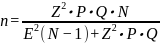
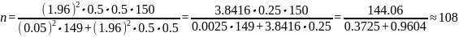

<!-- Copia pública del PDT. La solicitud y la autorización escaneadas no están: contienen DNI, teléfonos y firmas. El original sigue en Drive. -->

**UNIVERSIDAD DE HUÁNUCO**

**FACULTAD DE INGENIERÍA**

**PROGRAMA ACADÉMICO DE INGENIERÍA DE SISTEMAS E INFORMÁTICA**

**"Influencia de una aplicación multiplataforma de búsqueda semántica conversacional en la experiencia de lectores de Tu Diario Huánuco, 2026"**

PARA OPTAR EL TÍTULO PROFESIONAL DE INGENIERO(A)

DE SISTEMAS E INFORMÁTICA

**AUTOR(A)S:** Trujillo Avila Marcel Alexander Javier

> Godoy Condezo Alejandro Jeanpier

HUÁNUCO – PERÚ

2026

**TIPO DEL TRABAJO DE INVESTIGACIÓN:**

- Tesis ( X )

- Trabajo de Suficiencia Profesional( )

- Trabajo de Investigación ( )

- Trabajo Académico ( )

**LÍNEA DE INVESTIGACIÓN:**

**AÑO DE LA LÍNEA DE INVESTIGACIÓN:** 2021

**CAMPO DE CONOCIMIENTO OCDE:**

**Área:** 2.00.00 -- Ingeniería, Tecnología

**Sub área:** 2.02.00 - Ingeniería eléctrica, Ingeniería electrónica

**Disciplina:** 2.02.04 - Ingeniería de sistemas y comunicaciones

**DATOS DEL PROGRAMA:**

**Nombre del Grado/Título a recibir:** Título Profesional de Ingeniero(a) de sistemas e informática

**Código del Programa:** P06

**Tipo de Financiamiento:**

- Propio ( X )

- UDH ( )

- Fondos Concursables ( )

**DATOS DEL AUTOR:**

Documento Nacional de Identidad (DNI):

**DATOS DEL ASESOR:**

Documento Nacional de Identidad (DNI):

Grado/Título:

Código ORCID:

**DATOS DE LOS JURADOS:**

| **N°** | **APELLIDOS Y NOMBRES** | **GRADO** | **DNI** | **Código ORCID** |
|--------|-------------------------|-----------|---------|------------------|
| 1      |                         |           |         |                  |
| 2      |                         |           |         |                  |
| 3      |                         |           |         |                  |

#  **Índice** 

[**Índice 3**](#índice)

[**Índice de tablas 7**](#índice-de-tablas)

[**Índice de figuras 8**](#índice-de-figuras)

[**CAPÍTULO 1 9**](#capítulo-1)

> [PROBLEMA DE INVESTIGACIÓN 9](#problema-de-investigación)
>
> [1.1 Descripción del Problema 9](#descripción-del-problema)
>
> [1.2 Formulación del Problema 12](#formulación-del-problema)
>
> [1.2.1 Problemas General 12](#problemas-general)
>
> [1.2.2 Problemas Específicos 12](#problemas-específicos)
>
> [1.2.3 Declaración de Variables 12](#declaración-de-variables)
>
> [1.3 Objetivos 13](#objetivos)
>
> [1.3.1 Objetivo General 13](#objetivo-general)
>
> [1.3.2 Objetivos Específicos 13](#objetivos-específicos)
>
> [1.4 Justificación de la Investigación 13](#justificación-de-la-investigación)
>
> [Justificación Teórica 13](#justificación-teórica)
>
> [Justificación Práctica 13](#justificación-práctica)
>
> [Justificación Metodológica 14](#justificación-metodológica)
>
> [Justificación Social 14](#justificación-social)
>
> [1.5 Limitaciones de la Investigación 14](#limitaciones-de-la-investigación)
>
> [1.6 Viabilidad de la Investigación 16](#viabilidad-de-la-investigación)
>
> [Viabilidad Técnica 16](#viabilidad-técnica)
>
> [Viabilidad Económica 16](#viabilidad-económica)
>
> [Viabilidad Operativa 17](#viabilidad-operativa)
>
> [Viabilidad Temporal 17](#viabilidad-temporal)

[**CAPÍTULO II 18**](#capítulo-ii)

> [MARCO TEÓRICO 18](#marco-teórico)
>
> [2.1 Antecedentes de la investigación 18](#antecedentes-de-la-investigación)
>
> [2.1.1 Antecedentes internacionales 18](#antecedentes-internacionales)
>
> [2.1.2 Antecedentes nacionales 20](#antecedentes-nacionales)
>
> [2.1.3 Antecedentes locales 21](#antecedentes-locales)
>
> [2.2 Bases Teóricas 22](#bases-teóricas)
>
> [2.2.1. Aplicaciones web modernas y arquitectura headless 22](#aplicaciones-web-modernas-y-arquitectura-headless)
>
> [2.2.2. Asistentes conversacionales y generación aumentada por recuperación 22](#asistentes-conversacionales-y-generación-aumentada-por-recuperación)
>
> [2.2.3. Experiencia de Lectores, TAM y Escala SUS 23](#experiencia-de-lectores-tam-y-escala-sus)
>
> [2.2.4. Periodismo digital regional y transformación tecnológica 23](#periodismo-digital-regional-y-transformación-tecnológica)
>
> [2.3 Definiciones Conceptuales 24](#definiciones-conceptuales)
>
> [2.4 Hipótesis 25](#hipótesis)
>
> [2.5 Variables 26](#variables)
>
> [2.5.1. Variable independiente 26](#variable-independiente)
>
> [2.5.2. Variable dependiente 26](#variable-dependiente)
>
> [2.6. Operacionalización de variables 27](#operacionalización-de-variables)

[**CAPÍTULO III 29**](#capítulo-iii)

> [METODOLOGÍA 29](#metodología)
>
> [3.1 Tipo y Nivel de Investigación 29](#tipo-y-nivel-de-investigación)
>
> [3.1.1 Tipo de Investigación 29](#tipo-de-investigación)
>
> [3.1.2 Enfoque y Nivel de Investigación 30](#enfoque-y-nivel-de-investigación)
>
> [3.2 Método de Investigación 30](#método-de-investigación)
>
> [3.3 Diseño de la Investigación 31](#diseño-de-la-investigación)
>
> [3.4 Población y Muestra 32](#población-y-muestra)
>
> [3.4.1 Población 32](#población)
>
> [3.4.2 Muestra 32](#muestra)
>
> [3.5 Técnicas e Instrumentos de Recolección de Datos 34](#técnicas-e-instrumentos-de-recolección-de-datos)
>
> [3.5.1 Técnicas 34](#técnicas)
>
> [3.5.2 Instrumentos 34](#instrumentos)
>
> [3.5.3 Juicio de Expertos y Validez 36](#juicio-de-expertos-y-validez)
>
> [3.5.4 Confiabilidad del Instrumento 37](#confiabilidad-del-instrumento)
>
> [3.5.5 Precisión Instrumental y Control de Tráfico RAG 37](#precisión-instrumental-y-control-de-tráfico-rag)
>
> [3.6 Técnicas e Instrumentos de Análisis e Interpretación de Datos 38](#técnicas-e-instrumentos-de-análisis-e-interpretación-de-datos)
>
> [3.6.1 Procesamiento y Análisis de Datos 38](#procesamiento-y-análisis-de-datos)
>
> [3.6.2 Prueba de Normalidad 39](#prueba-de-normalidad)
>
> [3.6.3 Selección del Contraste Estadístico (Muestras Relacionadas) 39](#selección-del-contraste-estadístico-muestras-relacionadas)
>
> [3.6.4 El Ritual de Significancia Estadística (5 Pasos) 40](#el-ritual-de-significancia-estadística-5-pasos)
>
> [3.7 Aspectos Éticos 42](#aspectos-éticos)

[**CAPÍTULO IV 44**](#capítulo-iv)

> [RECURSOS 44](#recursos)
>
> [4.1 Cronograma 44](#cronograma)
>
> [4.2 Presupuesto 46](#presupuesto)
>
> [4.2.1. Recursos Humanos 46](#recursos-humanos)
>
> [4.2.2. Recursos Materiales 46](#recursos-materiales)
>
> [4.2.3. Servicios Tecnológicos 47](#servicios-tecnológicos)
>
> [4.2.3 Resumen del Presupuesto Total 47](#resumen-del-presupuesto-total)
>
> [4.3. Fuente de Financiamiento 47](#fuente-de-financiamiento)

[**REFERENCIAS 48**](#referencias)

[**ANEXOS 52**](#anexos)

> [6.1 Matriz de Consistencia 52](#matriz-de-consistencia)
>
> [6.2 Instrumento de Recolección 55](#instrumento-de-recolección)
>
> [6.2.1 Fichas Técnicas de los Instrumentos 55](#fichas-técnicas-de-los-instrumentos)
>
> [6.2.2 Proceso de Validación por Juicio de Expertos y Confiabilidad 55](#proceso-de-validación-por-juicio-de-expertos-y-confiabilidad)
>
> [6.2.3 Escala de Usabilidad del Sistema (SUS Brooke, 1996) 55](#_heading=h.enxucgcc48fk)
>
> [6.2.4 Cuestionario de Satisfacción (Adaptado de TAM Davis, 1989) 56](#_heading=h.g61j5vhlygb1)
>
> [6.2.5 Ficha de Registro de Tareas de Búsqueda (Observación) 57](#ficha-de-registro-de-tareas-de-búsqueda-observación)
>
> [6.3 Consentimientos y Asentimientos Informados 57](#consentimientos-y-asentimientos-informados)
>
> [6.3.1 Consentimiento Informado (Para mayores de 18 años / Apoderados) 57](#_heading=h.3nsq6r2k8nrt)
>
> [6.3.2 Asentimiento Informado (Para participantes menores de 18 años) 58](#_heading=h.96393hz7243u)
>
> [6.4 Solicitud 59](#_heading=h.csm5tsmg8ky4)
>
> [6.6 Autorización 60](#autorización)

#  

# **Índice de tablas**

# **Índice de figuras**

# **CAPÍTULO 1**

## **PROBLEMA DE INVESTIGACIÓN**

### **1.1 Descripción del Problema**

La industria global del periodismo digital atraviesa una transformación estructural impulsada por el cambio en los hábitos de consumo informativo, el avance de la inteligencia artificial y la fragmentación de las audiencias. Según el Digital News Report 2025 del Reuters Institute de la Universidad de Oxford —basado en una encuesta aplicada a 100 000 personas en 48 mercados—, los medios tradicionales sufren una caída sostenida de audiencia, mientras las redes sociales, las plataformas de video y los agregadores algorítmicos como Google Discover capturan la atención (Newman et al., 2025).

Este escenario impone un desafío crítico: la producción de información de calidad ya no garantiza la retención del lector, requiriéndose experiencias digitales ágiles, interactivas y personalizadas. El informe de la Universidad de Oxford detalla que las suscripciones digitales se encuentran estancadas y la confianza en las noticias continúa en descenso, debilitando el vínculo entre los medios y sus audiencias (Newman et al., 2025). La integración de inteligencia artificial conversacional en la distribución de noticias surge como una alternativa frente a este desapego; en Brasil, los chatbots de inteligencia artificial ya representan el 9% de los canales de acceso a noticias, alcanzando una penetración equivalente a la de la prensa impresa (Newman et al., 2025).

En el Perú, la migración hacia los canales digitales es masiva. El Digital News Report 2025 aplicado a la audiencia peruana revela que el 81% de los ciudadanos consume noticias mediante medios en línea, frente a un 51% que recurre a la televisión y solo un 24% que utiliza la prensa escrita (Newman et al., 2025). Más del 75% de los usuarios hace uso de dispositivos móviles, consolidando al teléfono inteligente como la pantalla principal de consumo informativo nacional. El Consejo Consultivo de Radio y Televisión, en su Estudio cuantitativo sobre consumo radial y televisivo 2025, reporta que las redes sociales son el medio que los entrevistados consideran que más entretiene, educa e informa (Consejo Consultivo de Radio y Televisión \[CONCORTV\], 2025).

Esta transición tecnológica presenta una marcada brecha geográfica. Los medios nacionales líderes en Lima (como El Comercio, La República o RPP) operan con plataformas robustas equipadas con búsqueda semántica, muros de pago (paywalls), aplicaciones nativas y recomendación algorítmica. Los medios regionales y locales de las provincias peruanas mantienen un rezago tecnológico. La mayoría opera con portales basados en plantillas genéricas de WordPress sobre servicios de alojamiento compartido, sin motores de búsqueda inteligente, sin interacción conversacional y sin estrategias de personalización del contenido, limitando la experiencia de lectores y acelerando la pérdida de audiencias.

En la región de Huánuco, el periodismo digital refleja estas limitaciones técnicas. El diario digital Tu Diario Huánuco (tudiariohuanuco.pe) publica información diaria sobre acontecimientos políticos, sociales, deportivos y culturales locales. Su sitio web, alojado bajo un esquema de hosting compartido de WordPress, carece de un buscador semántico que comprenda la intención del usuario, de un asistente conversacional para consultas en lenguaje natural y de capacidades de Aplicación Web Progresiva (PWA) que optimicen el acceso móvil.

Esta configuración tecnológica afecta el comportamiento de los lectores locales. Al buscar noticias sobre distritos específicos (como Amarilis o Pillco Marca) o temas particulares (como obras viales o eventos culturales), el usuario debe navegar manualmente por las categorías del menú o interactuar con un buscador clásico que solo realiza coincidencias léxicas literales. Este proceso de recuperación ineficaz induce a los lectores a abandonar el portal, disminuyendo el tráfico propio del diario regional y limitando su viabilidad comercial.

Durante un diagnóstico exploratorio realizado en mayo de 2026 se analizaron las bitácoras del servidor de alojamiento (Hostinger), las cuales registraron un volumen promedio de 14 000 peticiones HTTP diarias. Al aplicar criterios de reducción telemétrica (descontando un promedio de 35 peticiones por página generadas por hojas de estilo, scripts e imágenes de WordPress, y depurando un 35% de tráfico de indexadores automatizados), se estimó una audiencia de aproximadamente 160 visitantes humanos diarios. Los análisis revelaron que los usuarios tardan en promedio 3.8 minutos (228 segundos) en localizar una noticia específica mediante el buscador tradicional de la plataforma, con una tasa de rebote del 72.00%, una duración de sesión promedio de 45 segundos y un número promedio de páginas consultadas de 1.2 por sesión, evidenciando una baja retención del lector en el portal digital. Un sondeo exploratorio aplicado a una muestra de 15 lectores recurrentes del portal confirmó que el 70.00% de los usuarios presenta dificultades y frustración al navegar por los menús clásicos y el 65.00% manifiesta insatisfacción con el mecanismo actual de localización de información. A nivel subjetivo, la aplicación de la escala estandarizada System Usability Scale (SUS) arrojó una puntuación promedio de 56.50 puntos, lo que califica la usabilidad del portal actual como "deficiente" (por debajo del umbral de aceptabilidad de 68 puntos). Estos resultados evidencian limitaciones severas en la experiencia de lectores, forzando al 80.00% de los usuarios a abandonar tudiariohuanuco.pe para recurrir a redes sociales externas a buscar noticias publicadas anteriormente.

El diario digital Tu Diario Huánuco presenta una experiencia de lectores deficiente en el proceso de búsqueda y recuperación de información periodística, evidenciada por una puntuación promedio de usabilidad de 56.50 puntos en la escala SUS, elevados tiempos de localización de noticias que promedian 3.8 minutos, una tasa de rebote del 72.00% y un 65.00% de insatisfacción en los usuarios, lo que genera la deserción de los lectores hacia redes sociales externas y disminuye el tráfico y la interacción directa con el portal web regional de Huánuco.

Tres actores componen el sistema contenedor del problema. En primer lugar, los lectores locales de Huánuco, quienes experimentan dificultades y pérdidas de tiempo al buscar noticias en el portal. En segundo lugar, el equipo editorial del diario, que carece de herramientas automatizadas para distribuir eficientemente sus notas de prensa. En tercer lugar, la infraestructura tecnológica actual, basada en un WordPress monolítico tradicional con alojamiento compartido, incapaz de procesar búsquedas semánticas o interacciones automáticas fluidas.

Ante esta problemática, se propone el desarrollo e implementación de una aplicación multiplataforma de búsqueda semántica conversacional para Tu Diario Huánuco. Esta propuesta tecnológica busca transformar el proceso de acceso a las noticias, reemplazando la navegación rígida por una interacción fluida en lenguaje natural mediante búsqueda semántica y la arquitectura de Generación Aumentada por Recuperación (RAG). Se sustenta científicamente en que la integración de bases de datos vectoriales con modelos de lenguaje (Gao et al., 2024) permite producir respuestas fácticas precisas sobre repositorios cerrados de datos, lo cual influirá favorablemente en la experiencia de lectores en sus tres dimensiones: usabilidad percibida, tiempo de búsqueda y satisfacción.

### 1.2 Formulación del Problema

#### 1.2.1 Problemas General

¿De qué manera influye una aplicación multiplataforma de búsqueda semántica conversacional en la experiencia de lectores de Tu Diario Huánuco, 2026?

#### 1.2.2 Problemas Específicos

¿De qué manera influye una aplicación multiplataforma de búsqueda semántica conversacional en la usabilidad percibida de lectores de Tu Diario Huánuco, 2026?

¿De qué manera influye una aplicación multiplataforma de búsqueda semántica conversacional en el tiempo de búsqueda de lectores de Tu Diario Huánuco, 2026?

¿De qué manera influye una aplicación multiplataforma de búsqueda semántica conversacional en la satisfacción de lectores de Tu Diario Huánuco, 2026?

#### 1.2.3 Declaración de Variables

Para el desarrollo de la investigación, se definen formalmente las siguientes variables:

- **Variable Independiente (V.I.):** Aplicación multiplataforma de búsqueda semántica conversacional.

- **Variable Dependiente (V.D.):** Experiencia de lectores.

La variable dependiente Experiencia de lectores se define metodológicamente como un constructo multidimensional y se operacionaliza en las siguientes tres dimensiones con sus respectivos indicadores:

- **Usabilidad percibida:** Medida a través de los indicadores de usabilidad general (factor Usability) y facilidad de aprendizaje (factor Learnability).

- **Tiempo de búsqueda:** Medido a través de los indicadores de tiempo promedio y número de clics.

- **Satisfacción:** Medida a través de los indicadores de satisfacción general e intención de reutilización.

### **1.3 Objetivos**

#### 1.3.1 Objetivo General

Determinar la influencia de una aplicación multiplataforma de búsqueda semántica conversacional en la experiencia de lectores de Tu Diario Huánuco, 2026.

#### 1.3.2 Objetivos Específicos

Determinar la influencia de una aplicación multiplataforma de búsqueda semántica conversacional en la usabilidad percibida de lectores de Tu Diario Huánuco, 2026.

Determinar la influencia de una aplicación multiplataforma de búsqueda semántica conversacional en el tiempo de búsqueda de lectores de Tu Diario Huánuco, 2026.

Determinar la influencia de una aplicación multiplataforma de búsqueda semántica conversacional en la satisfacción de lectores de Tu Diario Huánuco, 2026.

### 1.4 Justificación de la Investigación 

#### Justificación Teórica

La investigación contribuye teóricamente al campo del periodismo computacional y los sistemas de información en entornos regionales del Perú, un área escasamente explorada. El estudio se justifica al enriquecer la discusión académica sobre la retención de audiencias y la adopción de tecnologías inteligentes, analizando la tensión entre la automatización de resúmenes informativos y la conservación del tráfico web en portales periodísticos locales. Los hallazgos aportarán un marco conceptual útil para comprender la interacción conversacional de noticias en contextos de brecha tecnológica.

#### Justificación Práctica

El estudio genera un impacto directo en la plataforma de Tu Diario Huánuco mediante la implementación de una aplicación multiplataforma de búsqueda semántica conversacional que acelera la consulta informativa. El software desarrollado opera como un modelo transferible y de bajo costo para otros diarios de provincias que buscan reducir su brecha tecnológica frente a las plataformas de la capital.

#### Justificación Metodológica

La investigación se justifica metodológicamente al proponer un marco evaluativo que integra la medición de métricas objetivas de rendimiento del software con la recolección de percepciones subjetivas de usabilidad del usuario en interfaces web móviles. Este enfoque metodológico de validación cruzada sirve como guía procedimental replicable para futuros investigadores del programa académico que busquen evaluar de forma sistemática la eficacia de asistentes conversacionales basados en modelos de lenguaje sin recurrir a registros puramente descriptivos.

#### Justificación Social

El estudio tiene una alta relevancia social en la región de Huánuco, puesto que busca descentralizar el acceso a la información local y democratizar la lectura diaria para ciudadanos con diversos perfiles de alfabetización digital. Al habilitar la localización de acontecimientos distritales y eventos culturales locales mediante interacción en lenguaje natural (tanto escrito como hablado por comandos de voz), el sistema reduce las barreras de uso del portal web, promueve la participación informada y fomenta la preservación del debate público y la identidad comunitaria huanuqueña.

### 1.5 Limitaciones de la Investigación

**Limitación temporal:** La evaluación experimental se restringe a la fase de campo, prevista entre setiembre y diciembre de 2026, con 7 días de uso libre entre el pretest y el postest, lo que impide analizar efectos de retención a largo plazo o cambios estructurales en los ingresos publicitarios del medio. Estrategia de mitigación: Los resultados se interpretarán como efecto de corto plazo y se recomendará, como línea de investigación futura, un seguimiento con mediciones repetidas.

**Limitación espacial:** El estudio se limita a los lectores del portal digital Tu Diario Huánuco en la provincia de Huánuco, restringiendo la generalización directa de los resultados a audiencias nacionales con hábitos de consumo distintos. Estrategia de mitigación: Se describirá el perfil de la muestra (edad, sexo y dispositivo) para que se pueda valorar a qué audiencias se extienden los resultados.

**Limitación metodológica:** Al emplear un diseño preexperimental sin grupo de control paralelo, no es posible aislar por completo la influencia de factores externos (como eventos coyunturales locales que incrementen de manera atípica el interés por las noticias) en la motivación del usuario durante el experimento. Estrategia de mitigación: Se estandarizarán de forma rigurosa las tareas de búsqueda durante el pretest y postest y se evitará programar las mediciones durante periodos de alta volatilidad social o política local.

**Limitación de recursos:** El desarrollo se ejecuta bajo el esquema de autofinanciamiento de pregrado, lo que limita la infraestructura a un servidor privado virtual de plan básico y a los planes gratuitos de la base de datos y del modelo de lenguaje. Estrategia de mitigación: Se optimizará el consumo de recursos de software implementando mecanismos de caché de vectores y peticiones a nivel de cliente y servidor, limitando las consultas repetitivas al modelo LLM, y se ampliará el plan del servidor si la carga del experimento lo exige.

**Limitación de acceso:** La captación de participantes se realiza de forma no probabilística mediante el portal digital y las redes sociales del diario, lo que puede inducir un sesgo de selección hacia usuarios jóvenes con mayor afinidad digital. Estrategia de mitigación: La invitación se difundirá por el portal y las redes sociales del diario, los participantes se sortearán cuando los inscritos superen la cuota muestral y el sesgo de autoselección se declarará en la discusión de resultados.

**Limitación de conectividad móvil:** El tiempo de respuesta y la latencia del asistente conversacional basado en la nube dependen de la estabilidad y el ancho de banda de la red móvil (3G/4G/5G) de los usuarios locales en Huánuco, representando un factor externo que puede afectar las métricas de rendimiento registradas en el postest. Estrategia de mitigación: Los logs registrarán de forma diferenciada la latencia de procesamiento interno de la API en el servidor y el tiempo de red percibido por el navegador del usuario, permitiendo aislar la velocidad del software del impacto del ancho de banda regional.

**Limitación de interacción y retención de tráfico (Clic Cero):** El asistente, al proveer respuestas resumidas y sintetizadas en lenguaje natural dentro del chat, podría reducir la necesidad del lector de hacer clic y navegar en los artículos de noticia completos. La medición se restringe a la usabilidad percibida, el tiempo de búsqueda y la satisfacción, sin evaluar la canibalización de impresiones publicitarias del medio. Estrategia de mitigación: Se diseñará la interfaz de respuestas para que incluya de forma obligatoria e interactiva hipervínculos llamativos en cada fragmento citado, incentivando al usuario a visitar el artículo original.

### 1.6 Viabilidad de la Investigación 

#### **Viabilidad Técnica** 

La investigación es técnicamente viable porque las tecnologías requeridas para el desarrollo de la solución se encuentran disponibles, son de uso libre o cuentan con planes gratuitos suficientes para la fase experimental, y están dentro del dominio de conocimiento del investigador. El desarrollo de la aplicación web se realizará empleando frameworks modernos y ampliamente documentados (Next.js para la interfaz y FastAPI para los servicios), mientras que la integración del asistente conversacional se sustentará en arquitecturas de generación aumentada por recuperación utilizando bases de datos vectoriales de código abierto y servicios de inteligencia artificial con planes gratuitos. Adicionalmente, el diario digital Tu Diario Huánuco cuenta actualmente con una plataforma WordPress que expone de manera nativa una interfaz de programación de aplicaciones REST, lo que facilita la integración técnica entre el sitio existente y la nueva solución sin modificar la infraestructura del medio, salvo la instalación de un contador de clics en el portal para el pretest.

#### **Viabilidad Económica** 

La investigación es económicamente viable debido a que los costos asociados al desarrollo de la solución tecnológica son reducidos. La aplicación web se aloja en un servidor privado virtual de plan básico, cuyo costo asume el investigador, las herramientas de inteligencia artificial cuentan con cuotas gratuitas que cubren el volumen de pruebas previsto, y el sitio web del diario ya dispone de hosting contratado por la propia empresa periodística. Los gastos restantes corresponden a materiales de oficina, impresiones, movilidad para la aplicación de instrumentos y otros costos menores que serán asumidos por el investigador en el marco del autofinanciamiento de la tesis, sin que ello comprometa la ejecución del estudio. El presupuesto total asciende a S/ 3,776.00 y se detalla en la sección 4.2.

#### **Viabilidad** Operativa 

Desde el punto de vista operativo, la investigación cuenta con condiciones favorables para su ejecución. El investigador desempeña funciones como desarrollador en el diario digital Tu Diario Huánuco, lo que le otorga acceso directo a la plataforma, conocimiento del flujo editorial y respaldo institucional del medio para implementar y evaluar la solución propuesta. Asimismo, la captación de la muestra de lectores se realizará mediante difusión a través de los canales propios del diario, redes sociales y muestreo por conveniencia aplicando criterios de inclusión claros, lo que asegura el acceso oportuno a los participantes del estudio. La aplicación de los instrumentos pretest y postest se realizará de manera digital mediante el módulo de gestión del experimento de la propia aplicación, facilitando la recolección y procesamiento de datos.

#### **Viabilidad** Temporal 

El estudio se enmarca dentro del cronograma académico establecido por la Universidad de Huánuco para el desarrollo de la tesis de pregrado, distribuyendo las actividades en doce meses, según el cronograma de la sección 4.1. Este periodo resulta suficiente para completar las fases de revisión bibliográfica, desarrollo iterativo de la solución tecnológica mediante una metodología ágil, aplicación del pretest, intervención experimental, aplicación del postest, análisis estadístico de los datos y redacción del informe final. La planificación se ha estructurado en sprints quincenales que permiten avanzar de forma paralela en el desarrollo del software y en la elaboración de los capítulos del informe, optimizando el uso del tiempo disponible.

# **CAPÍTULO II**

## **MARCO TEÓRICO**

### **2.1 Antecedentes de la investigación**

Los antecedentes de la presente investigación se han organizado en tres ámbitos geográficos: internacional, nacional y local, considerando estudios publicados en los últimos cinco años que abordan la aplicación de tecnologías conversacionales basadas en inteligencia artificial, sistemas de información web y la evaluación de la experiencia de usuario en plataformas digitales. Esta organización permite contextualizar el problema de investigación desde una perspectiva global hasta el ámbito local de Huánuco.

#### 2.1.1 Antecedentes internacionales

Spatharioti et al. (2025), en su artículo “Effects of LLM-based search on decision making: Speed, accuracy, and overreliance” presentado en la conferencia CHI 2025 de la Association for Computing Machinery, tuvieron como objetivo examinar cómo la búsqueda basada en modelos de lenguaje afecta el comportamiento de los usuarios frente a la búsqueda tradicional. La metodología comprendió dos experimentos en línea; en el primero, de grupos independientes con asignación aleatoria, 90 participantes de Estados Unidos resolvieron tareas de decisión con un buscador tradicional o con un buscador basado en un modelo de lenguaje, y se registraron el tiempo de la tarea, el número de consultas, la exactitud de la decisión y la valoración de la experiencia. Los resultados mostraron que el grupo con búsqueda basada en modelo de lenguaje completó las tareas en menos tiempo (1.6 frente a 3.4 minutos, p \< 0.001), con menos consultas (1.9 frente a 2.5, p = 0.02) y con una mejor valoración de la experiencia (4.41 frente a 3.10 sobre 5, p \< 0.001); sin embargo, cuando el modelo entregaba una respuesta errónea, la exactitud de las decisiones fue de 47% frente a 93% con el buscador tradicional (p \< 0.001). Los autores concluyen que la búsqueda conversacional es más rápida y satisfactoria, pero puede generar una confianza excesiva en respuestas incorrectas. Este antecedente se relaciona con la variable dependiente de la presente investigación porque mide el tiempo de búsqueda y la satisfacción al comparar un buscador tradicional con uno conversacional, y sustenta que el asistente muestre las fuentes de cada respuesta.

Kaushik y Jones (2023), en su ponencia “Comparing conventional and conversational search interaction using implicit evaluation methods” publicada en las actas de la conferencia HUCAPP 2023, tuvieron como objetivo comparar una interfaz de búsqueda convencional con una interfaz de búsqueda conversacional mediada por un agente. El estudio, realizado en Irlanda, empleó un diseño intrasujeto en laboratorio: 25 participantes resolvieron tareas de búsqueda con ambas interfaces y respondieron cuestionarios de carga de trabajo (NASA-TLX), usabilidad (PSSUQ) y experiencia de usuario (UEQ-S). Los resultados, analizados con la prueba t (α = 0.05), favorecieron a la interfaz conversacional en facilidad de uso (5.96 frente a 4.04), rapidez para completar el trabajo (5.76 frente a 3.72) y satisfacción general (5.92 frente a 4.16), con p \< 0.001 en los tres casos; además, el 92% de los participantes prefirió la interfaz conversacional. Los autores concluyen que la interfaz conversacional ofrece una mejor experiencia de búsqueda que la convencional. Este antecedente se relaciona con la presente investigación porque el mismo grupo evalúa los dos sistemas, como en el diseño de pretest y postest, y porque mide la usabilidad percibida y la satisfacción.

Ren et al. (2023), en su artículo “Using the SOCIO chatbot for UML modelling: A family of experiments” publicado en la revista IEEE Transactions on Software Engineering, tuvieron como objetivo comparar la usabilidad de un chatbot de modelado colaborativo (SOCIO) con la de una herramienta web en línea (Creately). La metodología consistió en una familia de tres experimentos con diseño cruzado intrasujeto, en la que participaron 132 estudiantes organizados en 44 equipos; se midieron la satisfacción con una versión adaptada de la escala SUS, el tiempo de la tarea, la completitud y la calidad de los diagramas. Los resultados, obtenidos con modelos lineales mixtos, indicaron que los equipos fueron más rápidos con el chatbot (con la herramienta web tardaron en promedio 1 minuto y 8 segundos más, p \< 0.05), mientras que la mayor satisfacción con el chatbot no alcanzó significancia al 5% (p = 0.0714) y la completitud no mostró diferencias (p = 0.7955). Los autores concluyen que los participantes construyeron los diagramas más rápido con el chatbot y se mostraron más satisfechos con él. Este antecedente se relaciona con la presente investigación porque emplea la escala SUS y el tiempo de tarea para comparar un chatbot con una aplicación web convencional, y advierte que la mejora en satisfacción puede no resultar significativa.

Garcia Bocanegra (2022), en su trabajo de grado de pregrado titulado “Implementación de un sistema virtual (chatbot) para la atención al cliente sobre la información de trámites al ciudadano por medio de interacciones conversacionales, para la Secretaría de Educación de la ciudad de Girardot en el año 2022” presentado en la Universidad Piloto de Colombia, desarrolló un asistente conversacional web. El objetivo de la investigación fue facilitar un asistente virtual para resolver consultas en línea. El tipo de investigación fue aplicada con un enfoque mixto. Se empleó la metodología XP y herramientas de software libre para la construcción de la plataforma web. Se aplicaron entrevistas y análisis documental como instrumentos de recolección de datos. El resultado fue una aplicación web con chatbot, sometida a pruebas de funcionalidad; el estudio no reporta una evaluación cuantitativa con usuarios. Este antecedente se relaciona con la variable independiente de la presente investigación, como referencia del desarrollo de un asistente conversacional web.

Tran (2022), en su tesis doctoral titulada “Implications of chatbot implementation on consumer sentiment and expectations towards service quality in consumer services” presentada en la Swinburne University of Technology de Australia, investigó la percepción de los usuarios frente a la inteligencia artificial conversacional. El objetivo principal fue analizar cómo los chatbots influyen en el sentimiento del consumidor y en las expectativas de calidad de servicio en plataformas digitales. La tesis examina las diferencias en el sentimiento de los consumidores hacia los chatbots entre sectores, su necesidad de contacto humano durante la interacción y la influencia de los chatbots en sus expectativas frente a la atención con agentes humanos. Este antecedente se relaciona con la dimensión satisfacción de la presente investigación, aunque no mide usabilidad ni tiempos de búsqueda.

### **2.1.2 Antecedentes nacionales**

Herrera Santa Cruz (2026), en su tesis titulada “Implementación de un chatbot para la optimización de la atención de consultas académicas y administrativas en la Escuela Profesional de Ingeniería de Sistemas de la UNSCH, 2025” presentada en la Universidad Nacional de San Cristóbal de Huamanga para optar el título de ingeniera de sistemas, tuvo como objetivo evaluar la implementación de un chatbot para mejorar la atención de consultas. La investigación fue de diseño preexperimental con un solo grupo y mediciones antes y después de la intervención (O1 X O2), con una muestra de 220 estudiantes y un cuestionario basado en la norma ISO/IEC 25010 que evaluó funcionalidad, fiabilidad, usabilidad, eficacia, eficiencia y satisfacción. Los resultados mostraron diferencias estadísticamente significativas en todas las dimensiones (p \< 0.001), con tamaños del efecto grandes (r ≥ 0.68), y un tiempo medio de respuesta del chatbot de 7.50 segundos. La autora concluye que el chatbot mejoró la atención de las consultas. Este antecedente se relaciona con la presente investigación porque aplica el mismo diseño preexperimental a un asistente conversacional con inteligencia artificial y evalúa la usabilidad, la eficiencia y la satisfacción de sus usuarios.

Arapa Mejia et al. (2024), en su artículo “Influence of a chatbot based on a conversational agent on the adaptability of first-year students of a Peruvian private university” publicado en la revista Frontiers in Education, tuvieron como objetivo evaluar la influencia de un chatbot basado en un agente conversacional en la adaptabilidad de estudiantes de primer año de una universidad privada del Perú. El diseño fue preexperimental con enfoque cuantitativo y mediciones de pretest y postest, sobre una muestra de 53 estudiantes seleccionados por conveniencia; se aplicó un cuestionario de adaptación a la vida universitaria de 11 ítems (α de Cronbach = 0.95) y un cuestionario de usabilidad de chatbots (CUQ). Los resultados, analizados con la prueba de Wilcoxon, mostraron una mejora significativa en la adaptabilidad global (de 3.95 a 4.32, p \< 0.001), en la dimensión social (p \< 0.001) y en la académica (p = 0.044), pero no en la institucional (p = 0.124). Los autores concluyen que el chatbot es una oportunidad prometedora para mejorar la adaptabilidad de los estudiantes. Este antecedente se relaciona con la presente investigación porque emplea el mismo diseño y el mismo verbo de efecto (influencia) para evaluar un agente conversacional, e incluye la medición de la experiencia de uso del chatbot.

Espinosa-Luna et al. (2023), en su artículo “Implementación de un chatbot basado en modelo de lenguaje de inteligencia artificial para responder preguntas frecuentes de estudiantes universitarios” publicado en la Revista Científica de Sistemas e Informática, tuvieron como objetivo desarrollar un chatbot con el modelo de lenguaje GPT-3.5-Turbo y evaluar su usabilidad percibida por estudiantes de primer ciclo de Ingeniería de Sistemas de la Universidad Nacional de Trujillo. El diseño fue preexperimental, con una muestra de 41 estudiantes y el cuestionario de usabilidad de chatbots (CUQ) de 16 ítems. Los resultados, analizados con la prueba t de Student para una muestra frente al valor de referencia 68, arrojaron un puntaje promedio de 73.4 (DE = 10.1; t = 3.396, p = 0.002), y el 93% de los estudiantes consideró útiles las respuestas del asistente. Los autores concluyen que el chatbot presenta un nivel de usabilidad percibida aceptable, con debilidades en la comprensión de las preguntas y en la naturalidad de las respuestas. Este antecedente se relaciona con la dimensión usabilidad percibida de la presente investigación, porque evalúa un asistente basado en un modelo de lenguaje y contrasta su puntaje con el umbral de 68 puntos.

Tapia Hoyos (2025), en su tesis titulada “Comunicación virtual usando chatbot para atención de estudiantes en la oficina de Asuntos Académicos de la UNSM” presentada en la Universidad Nacional de San Martín para optar el título de ingeniero de sistemas e informática, tuvo como objetivo determinar la influencia de la comunicación virtual mediante un chatbot en la atención a los estudiantes. La investigación fue aplicada, de enfoque cuantitativo y diseño preexperimental con pretest y postest, sobre una muestra de 135 estudiantes; se empleó un cuestionario validado por expertos (alfa de Cronbach = 0.854). En el diagnóstico inicial, el 46% de los estudiantes percibía la atención como deficiente, mientras que en el postest el 59% la calificó como buena; la prueba t para muestras emparejadas confirmó que el cambio fue estadísticamente significativo (p \< 0.001). El autor concluye que el chatbot influyó significativamente en la mejora de la atención. Este antecedente se relaciona con la dimensión satisfacción de la presente investigación, porque mide la percepción de los usuarios antes y después de usar un asistente conversacional.

### **2.1.3 Antecedentes locales**

Huerta Justo y Nolasco Ponce (2026), en su tesis titulada “Diseño e implementación de una página web con chatbot basado en inteligencia artificial integrado para optimizar la atención al cliente en la empresa Inkanet, Huánuco 2024” presentada en la Universidad Nacional Hermilio Valdizán para optar el título de ingeniero de sistemas, tuvieron como objetivo analizar el impacto de una página web con asistente virtual basado en inteligencia artificial en la atención al cliente. La investigación fue de enfoque cuantitativo y diseño preexperimental con pretest y postest en un solo grupo, sobre una muestra de 200 clientes, a quienes se aplicó un cuestionario estructurado antes y después de la implementación. Los resultados, analizados con la prueba t de Student para muestras relacionadas (α = 0.05), mostraron diferencias significativas en la satisfacción del cliente (p = 0.003) y en la retención de clientes (p \< 0.001), pero no en la eficiencia de los procesos administrativos (p = 0.116). Este antecedente se relaciona directamente con la presente investigación porque evalúa en Huánuco, con el mismo diseño, una aplicación web con asistente conversacional, y respalda la medición de la dimensión satisfacción.

Joaquin Perez (2026), en su tesis titulada “Chatbot para mejorar la atención a los clientes de la ferreteria Willy” presentada en la Universidad de Huánuco para optar el título de ingeniero de sistemas e informática, tuvo como objetivo implementar un asistente virtual para mejorar la atención a los clientes. La investigación fue aplicada, de enfoque cuantitativo y diseño preexperimental, con una muestra de 50 clientes seleccionados por conveniencia de una población de 120, a quienes se aplicó un cuestionario con escala de Likert. Los resultados, analizados con la prueba de Wilcoxon, evidenciaron una mejora significativa en la atención (Z = -6.158, p \< 0.001), con avances en la rapidez de atención y en la precisión de la información. El autor concluye que el chatbot mejoró la atención a los clientes. Este antecedente se relaciona con la presente investigación porque sustenta, en el ámbito local y en la misma universidad, el uso del diseño preexperimental y de la prueba de Wilcoxon para evaluar un asistente conversacional.

Medina Tixe (2026), en su tesis titulada “Plataforma web para mejorar el proceso de servicio social en los estudiantes del programa académico de educación básica de la Universidad de Huánuco - 2025” presentada en la Universidad de Huánuco para optar el título de ingeniero de sistemas e informática, tuvo como objetivo mejorar el proceso de servicio social mediante una plataforma web. La investigación fue aplicada, de enfoque cuantitativo y diseño preexperimental, con una población de 111 estudiantes y una muestra de 60, a quienes se aplicó un cuestionario con escala de Likert. Los resultados, contrastados con la prueba t de Student para muestras relacionadas con un nivel de significancia del 5%, mostraron que las respuestas favorables sobre los tiempos operativos aumentaron de 10% a 95% y las valoraciones positivas del acceso a la información, de 20% a 90%. Este antecedente se relaciona con la dimensión tiempo de búsqueda de la presente investigación, porque evidencia en la Universidad de Huánuco que una aplicación web reduce los tiempos del proceso y mejora el acceso a la información.

### 2.2 Bases Teóricas

Las bases teóricas que sustentan la presente investigación se organizan en cuatro grandes ejes conceptuales que corresponden a las variables del estudio. El primer eje aborda los fundamentos de las aplicaciones web modernas y las arquitecturas headless; el segundo eje desarrolla la teoría de los asistentes conversacionales y la generación aumentada por recuperación; el tercer eje presenta los modelos teóricos de experiencia de lectores, con énfasis en el modelo de aceptación tecnológica y la escala de usabilidad del sistema; y el cuarto eje contextualiza el periodismo digital regional y sus desafíos contemporáneos.

#### 2.2.1. Aplicaciones web modernas y arquitectura headless

Una aplicación web es un sistema de software accesible mediante navegador, alojado en un servidor remoto. La arquitectura headless separa completamente la capa de presentación (frontend) de la capa de almacenamiento y gestión de contenido (backend). En el ámbito periodístico, esto permite que un gestor tradicional como WordPress siga sirviendo a la redacción, mientras un frontend moderno (como React o Next.js) consume el contenido vía API REST. La implementación de capacidades PWA (Progressive Web App) dota al frontend de características nativas (instalación, funcionamiento sin conexión, notificaciones push), optimizando la retención móvil.

#### 2.2.2. Asistentes conversacionales y generación aumentada por recuperación

Un asistente conversacional interactúa con usuarios en lenguaje natural. La arquitectura RAG (Gao et al., 2024) combina modelos de lenguaje generativos (LLMs) con almacenamiento de información externa. Cuando el usuario consulta algo, el sistema vectoriza la consulta, busca coincidencias en una base de datos vectorial de noticias y le entrega los fragmentos relevantes al LLM como contexto. Esto evita las alucinaciones del modelo y asegura respuestas fácticas basadas estrictamente en la base de datos del periódico.

#### 2.2.3. Experiencia de Lectores, TAM y Escala SUS

La experiencia de lectores comprende las valoraciones cognitivas y afectivas surgidas al interactuar con un entorno digital de lectura (ISO 9241-210). El Modelo de Aceptación Tecnológica (TAM) de Davis (1989) postula que la utilidad percibida y la facilidad de uso percibida determinan la intención de adopción tecnológica. Para evaluar la usabilidad percibida, la escala SUS (Brooke, 1996) es el estándar internacional de 10 ítems Likert que genera una métrica global de 0 a 100 puntos.

#### 2.2.4. Periodismo digital regional y transformación tecnológica

Los medios regionales operan bajo restricciones presupuestarias y técnicas. Aunque el 81% de peruanos consume noticias en línea (Newman et al., 2025), los medios locales sufren de buscadores ineficaces basados en palabras clave exactas. La inteligencia artificial conversacional y RAG permiten cerrar esta brecha competitiva frente a los medios nacionales.

Sin embargo, la literatura del periodismo computacional advierte sobre dos tensiones críticas en esta integración. En primer lugar, la resistencia del usuario motivada por la desconfianza fáctica y el escepticismo hacia la información generada por inteligencia artificial; estudios de usabilidad revelan que los lectores de noticias de prensa demandan transparencia editorial humana y rechazan las interfaces conversacionales si perciben respuestas imprecisas o alucinadas. En segundo lugar, el fenómeno de la “búsqueda de clic cero” (zero-click search) representa una amenaza para la sostenibilidad económica del diario. Al proveer resúmenes exhaustivos de las noticias directamente en el chat, el asistente conversacional puede satisfacer la necesidad de información del usuario sin que este visite los enlaces de los artículos individuales. Esto canibaliza las vistas de página y las impresiones de publicidad programática, obligando a diseñar interfaces que equilibren la inmediatez conversacional con incentivos de navegación (enlaces y referencias visibles) hacia el contenido completo del portal.

### 2.3 Definiciones Conceptuales

Para garantizar la comprensión unívoca de los conceptos empleados en la presente investigación, se definen a continuación los términos básicos que aparecen recurrentemente a lo largo del documento.

**Aplicación web.** Sistema de software accesible a través de navegador, alojado de manera centralizada en un servidor (Sommerville, 2011, p. 112).

**Aplicación web progresiva.** Tipo de aplicación web que combina las mejores características de los sitios web tradicionales y las aplicaciones nativas, ofreciendo instalación en dispositivos, funcionamiento parcial sin conexión y notificaciones push.

**Asistente conversacional.** Software que simula un diálogo en lenguaje natural interactuando con usuarios humanos (Schöbel et al., 2024, p. 730).

**Base de datos vectorial.** Motor de base de datos optimizado para almacenar y consultar vectores que representan el significado semántico de un texto (Pan et al., 2024, p. 1591).

**Experiencia de lectores:** Percepciones y respuestas resultantes del uso o uso anticipado de un producto o servicio por parte de la audiencia lectora (ISO 9241-210, 2010, p. 3).

**Generación aumentada por recuperación (RAG):** Técnica que complementa las respuestas de un modelo de lenguaje recuperando información externa antes de generar el texto (Gao et al., 2024, p. 5).

**Modelo de aceptación tecnológica (TAM):** Modelo que predice la adopción tecnológica basándose en la utilidad y facilidad de uso percibidas (Davis, 1989, p. 320).

***System Usability Scale* (SUS):** Escala estandarizada de 10 ítems tipo Likert para obtener una valoración cuantitativa de la usabilidad percibida (Brooke, 1996, p. 4).

**Diario digital.** Medio periodístico que distribuye su contenido informativo exclusiva o principalmente a través de plataformas digitales accesibles vía internet, ya sea como sitio web, aplicación móvil o sus combinaciones.

***Embedding.*** Representación numérica vectorial de un texto, palabra o documento generada por un modelo de aprendizaje automático, que captura las propiedades semánticas del contenido y permite calcular similitudes entre elementos.

**Experiencia de usuario.** Conjunto de percepciones, emociones y respuestas que un usuario experimenta al interactuar con un producto, sistema o servicio, abarcando dimensiones como usabilidad, satisfacción y utilidad percibida según la norma ISO 9241-210.

**Interfaz de programación de aplicaciones REST.** Conjunto de reglas y protocolos basados en el estilo arquitectónico de transferencia de estado representacional que permite la comunicación entre sistemas informáticos mediante peticiones HTTP estandarizadas.

**Modelo de lenguaje de gran escala.** Modelo de inteligencia artificial entrenado sobre grandes volúmenes de texto para predecir, generar y comprender lenguaje natural, con miles de millones de parámetros y capacidades emergentes de razonamiento.

**Satisfacción del usuario.** Estado afectivo positivo del usuario derivado de la evaluación subjetiva de su interacción con un sistema, producto o servicio, que constituye una dimensión central de la experiencia de usuario.

**Usabilidad percibida.** Grado subjetivo en que un usuario considera que un sistema es eficaz, eficiente y satisfactorio para alcanzar sus objetivos, evaluable mediante instrumentos estandarizados como la escala SUS.

**WordPress.** Sistema de gestión de contenido de código abierto basado en PHP y MySQL, ampliamente utilizado para el desarrollo de sitios web y blogs, incluyendo medios periodísticos digitales.

### 2.4 Hipótesis

Las hipótesis de la presente investigación se formulan en correspondencia con los objetivos planteados y se expresan como hipótesis estadísticas susceptibles de contrastación empírica mediante pruebas inferenciales apropiadas al diseño preexperimental adoptado.

**Hipótesis General:**

**Hi:** La aplicación multiplataforma de búsqueda semántica conversacional influye significativamente en la experiencia de lectores de Tu Diario Huánuco, 2026.

**H0:** La aplicación multiplataforma de búsqueda semántica conversacional no influye significativamente en la experiencia de lectores de Tu Diario Huánuco, 2026.

**Hipótesis Específicas:**

**Hi1:** La aplicación multiplataforma de búsqueda semántica conversacional influye significativamente en la usabilidad percibida de lectores de Tu Diario Huánuco, 2026.

**H01:** La aplicación multiplataforma de búsqueda semántica conversacional no influye significativamente en la usabilidad percibida de lectores de Tu Diario Huánuco, 2026.

**Hi2:** La aplicación multiplataforma de búsqueda semántica conversacional influye significativamente en el tiempo de búsqueda de lectores de Tu Diario Huánuco, 2026**.**

**H02:** La aplicación multiplataforma de búsqueda semántica conversacional no influye significativamente en el tiempo de búsqueda de lectores de Tu Diario Huánuco, 2026.

**Hi3:** La aplicación multiplataforma de búsqueda semántica conversacional influye significativamente en la satisfacción de lectores de Tu Diario Huánuco, 2026.

**H03:** La aplicación multiplataforma de búsqueda semántica conversacional no influye significativamente en la satisfacción de lectores de Tu Diario Huánuco, 2026.

### 2.5 Variables 

#### 2.5.1. Variable independiente

Aplicación multiplataforma de búsqueda semántica conversacional.

#### 2.5.2. Variable dependiente

Experiencia de lectores.

### 

### 2.6. Operacionalización de variables

**Tabla 1**

Matriz de operacionalización de variables

<table style="width:100%;">
<colgroup>
<col style="width: 10%" />
<col style="width: 13%" />
<col style="width: 12%" />
<col style="width: 8%" />
<col style="width: 11%" />
<col style="width: 9%" />
<col style="width: 7%" />
<col style="width: 6%" />
<col style="width: 18%" />
</colgroup>
<thead>
<tr>
<th><strong>Variable</strong></th>
<th><strong>Definición Conceptual</strong></th>
<th><strong>Definición Operacional</strong></th>
<th><strong>Dimensiones</strong></th>
<th><strong>Indicadores</strong></th>
<th><strong>Valor Final (Baremo)</strong></th>
<th><strong>Tipo</strong></th>
<th><strong>Escala</strong></th>
<th><strong>Técnica / Instrumento</strong></th>
</tr>
<tr>
<th><strong>VI: Aplicación multiplataforma de búsqueda semántica conversacional</strong></th>
<th>Aplicación web progresiva, utilizable en el navegador e instalable en el celular o la computadora, que recupera noticias por similitud semántica y responde en lenguaje natural citando sus fuentes, mediante generación aumentada por recuperación (Lewis et al., 2020; Gao et al., 2024).</th>
<th>Se implementa con microservicios en FastAPI, interfaz en Next.js, PostgreSQL con pgvector, Redis y el modelo de lenguaje Gemini. Sus indicadores se registran con el microservicio de telemetría y la ficha técnica del sistema, que además documenta los dispositivos en que funciona y se instala.</th>
<th>Dimensión 1: Búsqueda Semántica</th>
<th>
1.1 Tasa de recuperación de respuestas válidas.

1.2 Latencia de respuesta del asistente (tiempo al primer token).
</th>
<th>
0% – 100%

Segundos
</th>
<th>
Numérico Continuo

Numérico Continuo
</th>
<th>
Razón

Razón
</th>
<th>Análisis de logs del sistema / Ficha técnica del sistema</th>
</tr>
<tr>
<th></th>
<th></th>
<th></th>
<th>Dimensión 2: Interacción Conversacional</th>
<th>
2.1 Tasa de respuestas sustentadas en fuentes.

2.2 Disponibilidad mensual de la interfaz.
</th>
<th>
0% – 100%

0% – 100%
</th>
<th>
Numérico Discreto

Numérico Discreto
</th>
<th>
Razón

Razón
</th>
<th>Análisis Documental / Ficha técnica de logs del sistema</th>
</tr>
<tr>
<th><strong>V.D. Experiencia de lectores</strong></th>
<th>Constructo multidimensional que describe las percepciones y respuestas del lector al interactuar con el sistema (ISO 9241-210, 2010).</th>
<th>Se mide en el pretest (portal actual) y en el postest (aplicación multiplataforma de búsqueda semántica conversacional) con el cuestionario SUS, la ficha de registro de tiempos y clics y el cuestionario de satisfacción e intención de continuidad.</th>
<th>Dimensión 1: Usabilidad percibida</th>
<th>
1.1 Usabilidad general (factor Usability).

1.2 Facilidad de aprendizaje (factor Learnability).
</th>
<th>Puntaje SUS de 0 a 100</th>
<th>Numérico</th>
<th>
Ordinal

Ordinal
</th>
<th>t de Student o Wilcoxon (Condicionado a normalidad)</th>
</tr>
<tr>
<th></th>
<th></th>
<th></th>
<th>Dimensión 2: Tiempo de búsqueda</th>
<th>
2.1 Tiempo promedio de búsqueda.

2.2 Número de clics.
</th>
<th>
Segundos

Número de clics
</th>
<th>
Numérico Continuo

Numérico Discreto
</th>
<th>
Razón

Razón
</th>
<th>t de Student o Wilcoxon (Condicionado a normalidad)</th>
</tr>
<tr>
<th></th>
<th></th>
<th></th>
<th>Dimensión 3: Satisfacción</th>
<th>
3.1 Satisfacción general.

3.2 Intención de reutilización.
</th>
<th>Puntaje de 8 a 40</th>
<th>
Numérico

Numérico
</th>
<th>
Intervalo

Intervalo
</th>
<th>Encuesta / Cuestionario de satisfacción e intención de continuidad (adaptado de Bhattacherjee, 2001)</th>
</tr>
</thead>
<tbody>
</tbody>
</table>

# CAPÍTULO III

## METODOLOGÍA

## 3.1 Tipo y Nivel de Investigación

### 3.1.1 Tipo de Investigación

La investigación es de tipo aplicada, porque se orienta a resolver un problema práctico, la búsqueda de noticias en el portal de Tu Diario Huánuco, mediante conocimiento tecnológico existente. De acuerdo con la clasificación de Supo Condori y Zacarías Ventura (2024), el estudio cumple además los siguientes cuatro criterios metodológicos:

1.  **Según la intervención del investigador (Experimental):** Se realiza una manipulación deliberada y controlada de la Variable Independiente (Aplicación multiplataforma de búsqueda semántica conversacional) con el objetivo de observar su efecto causal directo sobre la Variable Dependiente (Experiencia de lectores) en el entorno digital del diario regional. Específicamente, corresponde a un diseño preexperimental.

2.  **Según la planificación de la toma de datos (Prospectiva):** Todos los datos primarios relativos a la usabilidad, el tiempo y la satisfacción se registran directamente por el investigador durante el desarrollo del experimento, sin utilizar información recolectada de forma histórica o retrospectiva.

3.  **Según el número de ocasiones en que se mide la variable (Longitudinal):** Las dimensiones de la variable dependiente se evalúan en dos momentos temporales distintos y secuenciales: una medición previa a la implantación del estímulo tecnológico (pretest) y una medición final posterior a la interacción directa con la plataforma (postest).

4.  **Según el número de variables de interés (Analítica):** El estudio no es descriptivo unidimensional, sino que tiene por propósito comprobar la relación de causalidad y covarianza estadística existente entre la variable independiente y la dependiente.

### 3.1.2 Enfoque y Nivel de Investigación

- **Enfoque: Cuantitativo-Positivista.** Emplea mediciones estructuradas de la experiencia de lectores antes y después de la intervención, y el análisis de la estadística descriptiva e inferencial para la contrastación objetiva de las hipótesis (Sánchez Carlessi et al., 2018).

- **Nivel de Investigación: Aplicativo.** Corresponde al nivel aplicativo porque busca mejorar una condición real mediante la implementación y evaluación de una solución tecnológica. Se interviene el proceso de búsqueda de noticias de los lectores de Tu Diario Huánuco mediante la aplicación multiplataforma de búsqueda semántica conversacional, y se contrasta el estado inicial (portal actual) con el estado final (Supo Condori y Zacarías Ventura, 2024).

## 3.2 Método de Investigación

La investigación utiliza el Método Científico Hipotético-Deductivo, el cual se desarrolla en cuatro etapas secuenciales (Ñaupas Paitán et al., 2018):

1.  **Observación del problema:** Identificación empírica de ineficiencias de búsqueda informativa en el portal clásico del diario, requiriendo un promedio de 3.8 minutos de localización y generando un 65.00% de insatisfacción y una usabilidad deficiente (56.50 puntos SUS).

2.  **Formulación de hipótesis:** Establecimiento de la hipótesis general que postula que la implantación de la aplicación multiplataforma de búsqueda semántica conversacional influye de manera estadísticamente significativa en la experiencia de lectores.

3.  **Deducción de consecuencias**: Operacionalización del constructo multidimensional de la variable dependiente en dimensiones e indicadores de usabilidad percibida, tiempo de búsqueda y satisfacción del usuario, asociándolos a instrumentos estandarizados (SUS, cuestionario de satisfacción e intención de continuidad y ficha de registro de tiempos y clics).

4.  **Contrastación empírica:** Recolección de datos mediante el pretest y postest en la muestra seleccionada por conveniencia y ejecución de la contrastación inferencial utilizando software estadístico (SPSS v28) para estimar el nivel de significancia de los resultados.

## 3.3 Diseño de la Investigación

El diseño metodológico adoptado es **Pre Experimental con pretest y postest sobre un solo grupo**. El esquema formal del diseño se representa de la siguiente manera (Hernández-Sampieri y Mendoza, 2018):

Donde:

- *G*: Grupo único experimental conformado por los lectores seleccionados en la muestra (n = 108).

- *O1 *: Pretest. Medición inicial del tiempo de localización (segundos y clics), la usabilidad percibida (escala SUS) y la satisfacción (cuestionario de satisfacción e intención de continuidad) utilizando la plataforma tradicional basada en menús.

- *X*: Estímulo o tratamiento. Introducción y uso de la aplicación multiplataforma de búsqueda semántica conversacional, que responde consultas en lenguaje natural mediante búsqueda semántica y generación aumentada por recuperación sobre las noticias de Tu Diario Huánuco, y cita la nota original en cada respuesta. Se usa desde el navegador o instalada como aplicación web progresiva en el celular o la computadora del participante.

- *O2 *: Postest. Medición de los mismos indicadores del pretest tras culminar el periodo de experimentación con la solución tecnológica: 7 días de uso libre, con al menos 3 sesiones de consulta verificadas con la telemetría.

- *Comparabilidad de las mediciones:* En el pretest y el postest los participantes resuelven tareas distintas pero equivalentes, agrupadas en dos conjuntos: A (tareas 1 y 2) y B (tareas 3 y 4). Para que el conjunto de tareas no se confunda con el efecto de la aplicación, el conjunto se asigna por la paridad del código del participante (GU-TDH): códigos pares, conjunto A en el pretest y B en el postest; códigos impares, B en el pretest y A en el postest. La equivalencia de ambos conjuntos se verifica en la prueba piloto comparando tiempos y clics. El diseño continúa siendo preexperimental, sin grupo control, lo que se reconoce como limitación.

##  

## 3.4 Población y Muestra

### 3.4.1 Población

La población de estudio está conformada por los lectores activos recurrentes del portal digital del diario regional localizados en el contexto de la provincia de Huánuco durante el segundo semestre del año 2026. La población de referencia se estima en N = 150 lectores recurrentes, a partir del conteo informal del tráfico del portal, porque el diario no cuenta con un padrón nominal de lectores (Otzen y Manterola, 2017).

1.  Criterios de Inclusión:

- Lectores del portal web mayores de 18 años.

- Frecuencia de lectura del portal superior a 2 veces por semana.

- Acceso regular a la plataforma desde dispositivos móviles.

- Firma y aceptación expresa del Consentimiento Informado digital.

2.  Criterios de Exclusión:

- Personal técnico, administrativo o de redacción perteneciente al diario.

- Usuarios con discapacidades cognitivas o visuales severas que impidan interactuar con pantallas móviles de manera táctil.

- Participantes que dejen incompleto el llenado de los instrumentos del pretest o postest.

### 3.4.2 Muestra

La muestra estará conformada por *n = 108* lectores, calculados a partir del conteo informal aproximado de la población accesible (*N = 150*) mediante la aplicación de la fórmula estadística para poblaciones finitas con un nivel de confianza del 95.00% (*Z = 1.96*), un margen de error máximo admisible del 5.00% (*E = 0.05*) y una varianza poblacional máxima de proporciones de éxito y fracaso de 0.50 (*P = Q = 0.50*)

Donde:

- *Z* = 1.96 (coeficiente para un nivel de confianza del 95.00%);

- *P* = 0.5, *Q* = 0.5 (máxima heterogeneidad y varianza poblacional esperada);

- *E* = 0.05 (error máximo admisible establecido en 5.00%);

- *N* = 150 (tamaño aproximado del conteo informal de la población accesible).

Reemplazando los valores en la fórmula:

La muestra final resultante es de n = 108 lectores.

Dicho tamaño muestral satisface además el requerimiento mínimo (n ≥50) para la validez de la prueba de normalidad de Kolmogorov-Smirnov en diseños preexperimentales. La técnica de selección empleada corresponde al Muestreo No Probabilístico por Conveniencia, el cual se justifica plenamente debido a que el portal carece de un marco muestral o padrón nominal preexistente para seleccionar a los visitantes de forma aleatoria estricta, procediéndose a convocar de manera abierta y voluntaria a los lectores, mediante el portal y las redes sociales del diario, durante el periodo experimental —contando con la debida autorización institucional de la dirección del diario— hasta completar la cuota muestral de 108 participantes que cumplan con la totalidad de los criterios de inclusión y ejecuten el protocolo de evaluación, conforme a lo establecido en la Guía GEPIYT-VRI-001 de la Universidad de Huánuco (2025b) y los criterios metodológicos de Hernández-Sampieri y Mendoza (2018), Arias (2012) y Otzen y Manterola (2017). Si se inscriben más voluntarios que la cuota muestral, los participantes se elegirán por sorteo entre los inscritos. Pueden participar familiares o amigos del investigador o de quien aplique los instrumentos solo si cumplen los criterios de inclusión; su vínculo se registra en el libro de códigos y los resultados se verifican también sin ellos (análisis de sensibilidad).

## 3.5 Técnicas e Instrumentos de Recolección de Datos

La recolección de información para la evaluación de la Variable Dependiente (Experiencia de lectores) se organiza a partir de sus tres dimensiones operacionales:

### 3.5.1 Técnicas

1.  Encuesta: Técnica basada en la aplicación de cuestionarios cerrados estructurados para la medición cuantitativa de percepciones subjetivas con puntajes en escala de intervalo (usabilidad percibida y nivel de satisfacción).

2.  Observación de datos: Técnica que registra de manera mecánica y objetiva las interacciones, tiempos reales de procesamiento y métricas cuantitativas continuas en el software sin intervención directa de juicio humano.

### 3.5.2 Instrumentos

1.  **Ficha Técnica 1: Cuestionario de Usabilidad del Sistema (SUS)**

- Técnica: Encuesta.

- Nombre: Cuestionario de Usabilidad del Sistema (System Usability Scale - SUS)

- Autor: Brooke (1996). Adaptación lingüística: Marcel Alexander Javier Trujillo Ávila

- Objetivo: Evaluar cuantitativamente la usabilidad percibida del portal actual y de la aplicación multiplataforma de búsqueda semántica conversacional.

- Estructura: 10 ítems en una dimensión (usabilidad percibida) con 2 indicadores: IND 1.1 usabilidad general, factor Usability (ítems 1, 2, 3, 5, 6, 7, 8 y 9) e IND 1.2 facilidad de aprendizaje, factor Learnability (ítems 4 y 10). Escala Likert de 5 puntos (1 = Totalmente en desacuerdo, 5 = Totalmente de acuerdo); puntaje global de 0 a 100.

- Calificación: en los ítems impares (redacción positiva) se resta 1 a la respuesta; en los pares (redacción negativa) se calcula 5 menos la respuesta. La suma de las contribuciones se multiplica por 2.5, con lo que se obtiene un puntaje global de 0 a 100. El puntaje global es el resultado principal para la hipótesis (t de Student o Wilcoxon) y se compara con el umbral de 68 puntos; los puntajes de los factores se reportan de forma descriptiva (Usability: suma de contribuciones × 3.125; Learnability: suma × 12.5, ambos de 0 a 100).

- Momento de aplicación: Pretest y postest.

- Tiempo de aplicación: 3 minutos por participante.

2.  **Ficha Técnica 2: Cuestionario de Satisfacción e Intención de Continuidad**

- Técnica: Encuesta.

- Nombre: Cuestionario de Satisfacción e Intención de Continuidad (adaptado de Bhattacherjee, 2001)

- Autor: Marcel Alexander Javier Trujillo Ávila (adaptado de Bhattacherjee, 2001; DeLone y McLean, 2003)

- Objetivo: Medir el nivel de satisfacción de uso y la intención de seguir usando el sistema.

- Estructura: 8 ítems en una dimensión (satisfacción) con 2 indicadores: IND 3.1 satisfacción general (ítems 1 a 6) e IND 3.2 intención de reutilización (ítems 7 y 8). Escala Likert de 5 puntos (1 = Totalmente en desacuerdo, 5 = Totalmente de acuerdo); puntaje total de 8 a 40.

- Momento de aplicación: Pretest y postest.

- Tiempo de aplicación: 4 minutos por participante.

3.  **Ficha Técnica 3: Ficha de Registro de Tiempos y Clicks (Logs de Interacción)**

- Técnica: Observación de datos (registro mecánico automatizado).

- Nombre: Ficha de Registro de Tiempos y Clics (registro automatizado)

- Autor: Marcel Alexander Javier Trujillo Ávila

- Objetivo: Registrar métricas objetivas de rendimiento temporal e interacción física del usuario al resolver tareas programadas de búsqueda.

- Estructura: 2 tareas de búsqueda por momento; en cada tarea se registran el tiempo (segundos) y el número de clics (enlaces, botones y envíos de búsqueda). Indicadores: IND 2.1 tiempo promedio de búsqueda e IND 2.2 número de clics, ambos en escala de razón. No tiene ítems.

- Momento de aplicación: Pretest y postest, con el mismo procedimiento automatizado.

- Tiempo de aplicación: Hasta 10 minutos por participante (tope de 5 minutos por tarea).

4.  **Ficha Técnica 4: Ficha Técnica del Sistema (Variable Independiente)**

- Técnica: Análisis de logs del sistema.

- Nombre: Ficha técnica del sistema.

- Autor: Marcel Alexander Javier Trujillo Ávila.

- Objetivo: Documentar el funcionamiento de la aplicación multiplataforma de búsqueda semántica conversacional (variable independiente) mediante indicadores técnicos, que se reportarán con estadística descriptiva.

- Estructura: 4 indicadores en 2 dimensiones. Búsqueda semántica: tasa de recuperación de respuestas válidas (consultas con al menos un fragmento recuperado bajo el umbral de distancia, sobre el total de consultas) y latencia de respuesta del asistente (tiempo al primer token, en segundos). Interacción conversacional: tasa de respuestas sustentadas en fuentes (respuestas que conservan al menos una fuente citada, sobre el total de respuestas) y disponibilidad mensual de la interfaz (chequeos exitosos sobre el total del mes, con un monitor externo cada 5 minutos). Además, registra la versión congelada de la aplicación y los dispositivos y navegadores en que se verificó su funcionamiento y su instalación como aplicación web progresiva.

- Momento de aplicación: Durante la intervención, con registro continuo.

- Tiempo de aplicación: No aplica; el registro es automático.

### 3.5.3 Juicio de Expertos y Validez

En estricto cumplimiento con la Guía GEPIYT-VRI-001 (Universidad de Huánuco, 2025b), el proceso de validez de contenido de los instrumentos se desglosa según su naturaleza originaria:

1.  **Cuestionario SUS (Instrumento Estandarizado):** Al ser una escala validada internacionalmente que se aplica en su traducción estándar al español, sin modificación sustancial, se somete a validación cualitativa mediante el Juicio de 2 Expertos y 1 Juez (expertos temáticos con grado de magíster o doctor y un juez con formación en investigación o estadística).

2.  **Cuestionario de Satisfacción e Intención de Continuidad (Instrumento Adaptado):** Debido a que los ítems se adaptaron de los constructos de satisfacción e intención de continuidad de Bhattacherjee (2001) y DeLone y McLean (2003) al contexto del periodismo digital de Huánuco, requiere la evaluación por el Juicio de 4 Expertos y 2 Jueces (expertos temáticos con grado de magíster o doctor y jueces con formación en investigación o estadística).

3.  **Ficha de Registro de Tiempos y Clics (Mecánico/Telemetría):** En concordancia con el protocolo UDH, goza de Exención de Validación al ser un instrumento de registro puramente mecánico/técnico que opera a nivel lógico de software libre de juicio metodológico humano. Se calibra internamente mediante pruebas controladas de latencia y de conteo de clics en el portal actual y en la aplicación.

4.  **Ficha Técnica del Sistema (Variable Independiente):** Al registrar datos generados automáticamente por el sistema, no requiere validación por juicio de expertos ni prueba de confiabilidad.

Los expertos evaluarán cada uno de los ítems de los cuestionarios empleando los 10 criterios institucionales: claridad, objetividad, actualidad, organización, suficiencia, intencionalidad, consistencia, coherencia, metodología y pertinencia. La validez de contenido se cuantificará con el coeficiente V de Aiken por ítem y criterio, y se aceptarán los ítems con V ≥ 0.80.

A fin de garantizar la validez racional (respaldo teórico) exigida por la UDH, se estructura la siguiente matriz de fundamentación de la Variable Dependiente:

||
||
||
||
||

## 3.5.4 Confiabilidad del Instrumento

La confiabilidad se establecerá mediante la aplicación de una prueba piloto con una muestra de np = 20 lectores (excluidos de la muestra experimental definitiva).

- Se aplicará el coeficiente de consistencia interna Alfa de Cronbach para escalas Likert (Cuestionario SUS y Cuestionario de Satisfacción). En el SUS se invertirán previamente los ítems pares, de redacción negativa.

- El instrumento se considerará confiable si alcanza un 0.70 coeficiente (Mínimo Aceptable según Gliem y Gliem, 2003).

### 3.5.5 Precisión Instrumental y Control de Tráfico RAG

Para el registro objetivo de los tiempos de búsqueda, la aplicación web incorporará herramientas de telemetría de rendimiento en la capa cliente y registros automatizados en las tablas relacionales de la base de datos centralizada del sistema, registrando marcas temporales con una precisión de milisegundos. A fin de controlar la variable externa de la conectividad móvil (latencias de red 3G/4G), el sistema registrará de forma aislada el tiempo de procesamiento de servidor (búsqueda vectorial en la base de datos y generación del modelo de lenguaje) y el tiempo total percibido por el cliente. En ambos momentos, el tiempo de cada tarea lo cronometrará el módulo de gestión del experimento, desde que presenta la tarea hasta que el participante registra la noticia encontrada. Los clics se contarán con un contador instalado en el portal actual (pretest) y con la telemetría de la aplicación (postest), con la misma definición de clic: enlaces, botones y envíos de búsqueda.

Asimismo, para mitigar el fenómeno del "cero clics" (zero-click search) que canibaliza el tráfico del diario al deparar resúmenes directos en el chat, el asistente conversacional RAG se diseñará con un esquema de retención de audiencia:

- **Citas enlazadas inline (Inline Reference Anchoring):** La lógica de generación exigirá estructurar las respuestas enlazando de forma obligatoria hipervínculos inline a la noticia del diario original que sirve de fuente.

- **Accordion de Fuentes**: La interfaz de presentación desplegará de forma persistente en un panel lateral interactivo los artículos periodísticos del diario que fueron recuperados para formular la síntesis, motivando la navegación profunda en la plataforma.

## 3.6 Técnicas e Instrumentos de Análisis e Interpretación de Datos

### 3.6.1 Procesamiento y Análisis de Datos

El procedimiento de análisis para transformar las mediciones crudas en resultados estructurados se desarrolla a través de las siguientes cuatro fases secuenciales:

1.  **Control de calidad de datos:** Verificación y auditoría de consistencia de los registros de logs automatizados en la base de datos central y descarte de cuestionarios inconclusos o registros duplicados, asegurando la limpieza y completitud del set de datos.

2.  **Codificación:** Asignación de códigos numéricos estandarizados a las respuestas de las escalas Likert (de 1 a 5) y conversión de las marcas de tiempo de la base de datos a segundos para preparar la matriz de datos definitiva.

3.  **Procesamiento estadístico:** Importación del archivo depurado en formato CSV al software SPSS v28 para la aplicación de estadística descriptiva (medias, desviaciones estándar, frecuencias) e inferencial (normalidad y contraste estadístico de hipótesis).

4.  **Presentación e interpretación:** Elaboración de tablas y figuras estadísticas estructuradas siguiendo las normas de publicación de la American Psychological Association (2020) bajo la adecuación de la Universidad de Huánuco (Mazeres Gaitero y Ruiz Aquino, 2024), seguidas de la discusión y análisis lógico de los resultados.

### 3.6.2 Prueba de Normalidad

Para decidir la aplicación de pruebas paramétricas o no paramétricas, se aplicará la prueba de normalidad de Kolmogorov-Smirnov sobre las diferencias del pretest y postest de la muestra final ($`n = 108 \geq 50`$), bajo las hipótesis:

- H0: Los datos de las diferencias provienen de una distribución normal ($`p > 0.05`$).

- Ha: Los datos de las diferencias no provienen de una distribución normal ($`p \leq 0.05`$).

### 3.6.3 Selección del Contraste Estadístico (Muestras Relacionadas)

Para contrastar las hipótesis inferenciales de las tres dimensiones de la variable dependiente se seleccionará el estadístico de comparación para muestras relacionadas de manera condicional al resultado de la prueba de normalidad de Kolmogorov-Smirnov:

- **Usabilidad percibida (Puntuación SUS):** Si se verifica distribución normal (**p\>0.05**), se aplicará la prueba paramétrica t de Student para muestras relacionadas; si la distribución es no normal (**p0.05**), se aplicará la prueba no paramétrica de Rangos con Signo de Wilcoxon. Se contrasta el puntaje SUS global (0 a 100) y se compara con el umbral de 68 puntos; los puntajes de los factores Usability y Learnability se reportan de forma descriptiva.

- **Tiempo de búsqueda (Segundos y Clics):** Si se verifica distribución normal (**p\>0.05**), se aplicará la prueba paramétrica t de Student para muestras relacionadas; si la distribución es no normal (**p0.05**), se aplicará la prueba no paramétrica de Rangos con Signo de Wilcoxon. El tiempo promedio de búsqueda es el indicador principal para decidir la hipótesis específica 2; el número de clics se reporta como indicador complementario.

- **Satisfacción (Puntaje Cuestionario):** Si se verifica distribución normal (**p\>0.05**), se aplicará la prueba paramétrica t de Student para muestras relacionadas; si la distribución es no normal (**p0.05**), se aplicará la prueba no paramétrica de Rangos con Signo de Wilcoxon. Se contrasta el puntaje total (8 a 40); los subpuntajes de los indicadores 3.1 y 3.2 se reportan de forma descriptiva.

Esta lógica de selección se resume a continuación:

||
||
||
||
||

### 3.6.4 El Ritual de Significancia Estadística (5 Pasos)

De acuerdo con las normativas metodológicas de la UDH, se ejecutará el formalismo inferencial en cinco etapas:

**Paso 1: Planteamiento de Hipótesis Estadísticas (\$H_0\$ y \$H_i\$)**

1.  **Hipótesis General:**

- Hi: La aplicación multiplataforma de búsqueda semántica conversacional influye significativamente en la experiencia de lectores de Tu Diario Huánuco, 2026. (p0.05)

- H0: La aplicación multiplataforma de búsqueda semántica conversacional no influye significativamente en la experiencia de lectores de Tu Diario Huánuco, 2026. (p\>0.05)

2.  **Hipótesis Específica 1 (Dimensión Usabilidad):**

- **Hi1:** La aplicación multiplataforma de búsqueda semántica conversacional influye significativamente en la usabilidad percibida de lectores de Tu Diario Huánuco, 2026. (p0.05)

- **H01:** La aplicación multiplataforma de búsqueda semántica conversacional no influye significativamente en la usabilidad percibida de lectores de Tu Diario Huánuco, 2026. (p\>0.05)

3.  **Hipótesis Específica 2 (Dimensión Tiempo de Búsqueda):**

- **Hi2:** La aplicación multiplataforma de búsqueda semántica conversacional influye significativamente en el tiempo de búsqueda de lectores de Tu Diario Huánuco, 2026. (p0.05)

- **H02:** La aplicación multiplataforma de búsqueda semántica conversacional no influye significativamente en el tiempo de búsqueda de lectores de Tu Diario Huánuco, 2026. (p\>0.05)

4.  **Hipótesis Específica 3 (Dimensión Satisfacción):**

- **Hi3**: La aplicación multiplataforma de búsqueda semántica conversacional influye significativamente en la satisfacción de lectores de Tu Diario Huánuco, 2026. (p0.05)

- **H03:** La aplicación multiplataforma de búsqueda semántica conversacional no influye significativamente en la satisfacción de lectores de Tu Diario Huánuco, 2026. (p\>0.05)

**Paso 2: Establecimiento del Nivel de Significancia (**$`\alpha`$**)**

El nivel de significancia se fija en $`\alpha = 0.05`$ (5%), operando con una confianza del 95% para la contrastación.

**Paso 3: Selección de la Prueba Estadística**

Se seleccionará la prueba estadística inferencial (t de Student para muestras relacionadas o Wilcoxon) para cada hipótesis específica de forma condicionada al resultado de la prueba de normalidad de Kolmogorov-Smirnov, según la lógica establecida en la sección 3.6.3. La hipótesis general se aceptará si se rechazan las tres hipótesis nulas específicas.

**Paso 4: Cálculo del Estadístico y p-valor**

Los datos recolectados se someterán al cálculo del estadístico y significancia bilateral asintótica (*p-valor*) a través del software SPSS v28. Se reportarán el estadístico, los grados de libertad, el p-valor y el tamaño del efecto (d de Cohen para la t de Student o r para Wilcoxon).

**Paso 5: Decisión Estadística**

- Si *p-valor 0.05*: Se rechaza la hipótesis nula (**H0**) y se acepta la hipótesis de investigación (**Hi**), concluyendo estadísticamente que la aplicación multiplataforma de búsqueda semántica conversacional influye significativamente en la dimensión evaluada de la experiencia de lectores de Tu Diario Huánuco, 2026.

- Si *p-valor \>0.05*: No se rechaza la hipótesis nula (**H0**), concluyendo estadísticamente que la aplicación multiplataforma de búsqueda semántica conversacional no influye significativamente en la dimensión evaluada de la experiencia de lectores de Tu Diario Huánuco, 2026.

## 3.7 Aspectos Éticos

La presente investigación se rige estrictamente bajo los marcos de la bioética del Informe Belmont (National Commission for the Protection of Human Subjects of Biomedical and Behavioral Research, 1979) y la Declaración de Helsinki (Asociación Médica Mundial, 2024), adaptándose además al Código de Ética de la UDH (Universidad de Huánuco, 2025a) y la legislación peruana:

1.  **Autonomía (Respeto):** Todos los participantes de la muestra firmarán electrónicamente un formulario de \*Consentimiento Informado\* previo a las pruebas de pretest. Se garantiza el derecho de retirarse del estudio en cualquier momento sin represalias.

2.  **Beneficencia y No Maleficencia:** El desarrollo de la solución se ejecuta e interactúa inicialmente en entornos locales de desarrollo contenerizados y aislados antes del despliegue en producción, protegiendo la operatividad del diario. El lector final se beneficia al optimizar su experiencia de navegación semántica.

3.  **Justicia:** Se asegura una selección equitativa de los lectores sin discriminación alguna, permitiendo que las mejoras del software sean accesibles para toda la comunidad lectora de forma libre y democrática.

4.  **Confidencialidad (Ley N.° 29733 - Ley de Protección de Datos Personales del Perú, 2011):** Para el control de participantes se registrarán nombres, apellidos y número de celular junto con el consentimiento informado, con la única finalidad de verificar la participación en el pretest y el postest y evitar inscripciones duplicadas; con ese mismo fin se guardará un identificador técnico del navegador. No se solicitará el DNI. Estos datos se custodiarán separados de la base de análisis, con acceso restringido al investigador y al asesor, y en dicha base cada participante figurará solo con un código. Los resultados se publicarán de forma anonimizada, y los datos personales se conservarán por el plazo declarado en el consentimiento informado y luego se eliminarán de forma segura.

5.  **Estándares de Calidad de Software:** Para dotar de rigor técnico en ingeniería a la evaluación del desempeño y usabilidad, se utiliza como marco teórico de calidad del producto de software la norma internacional ISO/IEC 25010:2023, sustentando técnicamente la validez científica de la usabilidad (SUS) e idoneidad funcional de las consultas.

# CAPÍTULO IV

## RECURSOS

### 4.1 Cronograma

<table>
<colgroup>
<col style="width: 3%" />
<col style="width: 53%" />
<col style="width: 3%" />
<col style="width: 3%" />
<col style="width: 3%" />
<col style="width: 3%" />
<col style="width: 3%" />
<col style="width: 3%" />
<col style="width: 3%" />
<col style="width: 3%" />
<col style="width: 3%" />
<col style="width: 4%" />
<col style="width: 4%" />
<col style="width: 4%" />
</colgroup>
<thead>
<tr>
<th colspan="2" rowspan="2" style="text-align: center;"><strong>ACTIVIDADES</strong></th>
<th rowspan="2" style="text-align: center;"><strong>M1</strong></th>
<th rowspan="2" style="text-align: center;"><strong>M2</strong></th>
<th rowspan="2" style="text-align: center;"><strong>M3</strong></th>
<th rowspan="2" style="text-align: center;"><strong>M4</strong></th>
<th rowspan="2" style="text-align: center;"><strong>M5</strong></th>
<th rowspan="2" style="text-align: center;"><strong>M6</strong></th>
<th rowspan="2" style="text-align: center;"><strong>M7</strong></th>
<th rowspan="2" style="text-align: center;"><strong>M8</strong></th>
<th rowspan="2" style="text-align: center;"><strong>M9</strong></th>
<th rowspan="2" style="text-align: center;"><strong>M10</strong></th>
<th rowspan="2" style="text-align: center;"><strong>M11</strong></th>
<th rowspan="2" style="text-align: center;"><strong>M12</strong></th>
</tr>
<tr>
</tr>
<tr>
<th colspan="2"><strong>Fase 1: Planificación e Instrumentos</strong></th>
<th></th>
<th></th>
<th></th>
<th></th>
<th></th>
<th></th>
<th></th>
<th></th>
<th></th>
<th></th>
<th></th>
<th></th>
</tr>
<tr>
<th></th>
<th>1. Búsqueda de literatura científica y marco teórico</th>
<th style="text-align: center;">X</th>
<th style="text-align: center;">X</th>
<th></th>
<th></th>
<th></th>
<th></th>
<th></th>
<th></th>
<th></th>
<th></th>
<th></th>
<th></th>
</tr>
<tr>
<th></th>
<th>2. Formulación de problemas, objetivos e hipótesis</th>
<th style="text-align: center;">X</th>
<th></th>
<th></th>
<th></th>
<th></th>
<th></th>
<th></th>
<th></th>
<th></th>
<th></th>
<th></th>
<th></th>
</tr>
<tr>
<th></th>
<th>3. Operacionalización de variables y diseño metodológico</th>
<th></th>
<th style="text-align: center;">X</th>
<th></th>
<th></th>
<th></th>
<th></th>
<th></th>
<th></th>
<th></th>
<th></th>
<th></th>
<th></th>
</tr>
<tr>
<th colspan="2"><strong>Fase 2: Desarrollo Tecnológico</strong></th>
<th></th>
<th></th>
<th></th>
<th></th>
<th></th>
<th></th>
<th></th>
<th></th>
<th></th>
<th></th>
<th></th>
<th></th>
</tr>
<tr>
<th></th>
<th>4. Análisis de requerimientos y diseño de la arquitectura</th>
<th></th>
<th></th>
<th style="text-align: center;">X</th>
<th></th>
<th></th>
<th></th>
<th></th>
<th></th>
<th></th>
<th></th>
<th></th>
<th></th>
</tr>
<tr>
<th></th>
<th>5. Programación de base de datos y backend (Supabase/FastAPI)</th>
<th></th>
<th></th>
<th></th>
<th style="text-align: center;">X</th>
<th style="text-align: center;">X</th>
<th></th>
<th></th>
<th></th>
<th></th>
<th></th>
<th></th>
<th></th>
</tr>
<tr>
<th></th>
<th>6. Desarrollo de interfaz del cliente (Next.js)</th>
<th></th>
<th></th>
<th></th>
<th></th>
<th style="text-align: center;">X</th>
<th style="text-align: center;">X</th>
<th></th>
<th></th>
<th></th>
<th></th>
<th></th>
<th></th>
</tr>
<tr>
<th></th>
<th>7. Pruebas de software e integración de RAG con enlaces inline</th>
<th></th>
<th></th>
<th></th>
<th></th>
<th></th>
<th style="text-align: center;">X</th>
<th></th>
<th></th>
<th></th>
<th></th>
<th></th>
<th></th>
</tr>
<tr>
<th colspan="2"><strong>Fase 3: Validación y Piloto</strong></th>
<th></th>
<th></th>
<th></th>
<th></th>
<th></th>
<th></th>
<th></th>
<th></th>
<th></th>
<th></th>
<th></th>
<th></th>
</tr>
<tr>
<th></th>
<th>8. Validación de instrumentos por juicio de expertos (V de Aiken)</th>
<th></th>
<th></th>
<th></th>
<th></th>
<th></th>
<th></th>
<th style="text-align: center;">X</th>
<th></th>
<th></th>
<th></th>
<th></th>
<th></th>
</tr>
<tr>
<th></th>
<th>9. Aplicación de prueba piloto y fiabilidad (n = 20)</th>
<th></th>
<th></th>
<th></th>
<th></th>
<th></th>
<th></th>
<th style="text-align: center;">X</th>
<th></th>
<th></th>
<th></th>
<th></th>
<th></th>
</tr>
<tr>
<th colspan="2"><strong>Fase 4: Ejecución Experimental (Trabajo de Campo)</strong></th>
<th></th>
<th></th>
<th></th>
<th></th>
<th></th>
<th></th>
<th></th>
<th></th>
<th></th>
<th></th>
<th></th>
<th></th>
</tr>
<tr>
<th></th>
<th>10. Firma de consentimientos informados y toma de Pretest (O1)</th>
<th></th>
<th></th>
<th></th>
<th></th>
<th></th>
<th></th>
<th></th>
<th style="text-align: center;">X</th>
<th></th>
<th></th>
<th></th>
<th></th>
</tr>
<tr>
<th></th>
<th>11. Despliegue en producción y exposición experimental al estímulo (X)</th>
<th></th>
<th></th>
<th></th>
<th></th>
<th></th>
<th></th>
<th></th>
<th></th>
<th style="text-align: center;">X</th>
<th style="text-align: center;">X</th>
<th></th>
<th></th>
</tr>
<tr>
<th></th>
<th>12. Toma de Postest (O2) en la muestra experimental (n = 108)</th>
<th></th>
<th></th>
<th></th>
<th></th>
<th></th>
<th></th>
<th></th>
<th></th>
<th></th>
<th></th>
<th style="text-align: center;">X</th>
<th></th>
</tr>
<tr>
<th colspan="2"><strong>Fase 5: Informe Final y Publicación</strong></th>
<th></th>
<th></th>
<th></th>
<th></th>
<th></th>
<th></th>
<th></th>
<th></th>
<th></th>
<th></th>
<th></th>
<th></th>
</tr>
<tr>
<th></th>
<th>13. Procesamiento estadístico y contrastación de hipótesis</th>
<th></th>
<th></th>
<th></th>
<th></th>
<th></th>
<th></th>
<th></th>
<th></th>
<th></th>
<th></th>
<th style="text-align: center;">X</th>
<th></th>
</tr>
<tr>
<th></th>
<th>14. Redacción de discusión de resultados y borrador de tesis</th>
<th></th>
<th></th>
<th></th>
<th></th>
<th></th>
<th></th>
<th></th>
<th></th>
<th></th>
<th></th>
<th></th>
<th style="text-align: center;">X</th>
</tr>
<tr>
<th></th>
<th>15. Corrección de observaciones y sustentación de la tesis</th>
<th></th>
<th></th>
<th></th>
<th></th>
<th></th>
<th></th>
<th></th>
<th></th>
<th></th>
<th></th>
<th></th>
<th style="text-align: center;">X</th>
</tr>
<tr>
<th></th>
<th>16. Preparación y sometimiento de artículo científico (Scopus/SciELO)</th>
<th></th>
<th></th>
<th></th>
<th></th>
<th></th>
<th></th>
<th></th>
<th></th>
<th></th>
<th></th>
<th></th>
<th style="text-align: center;">X</th>
</tr>
</thead>
<tbody>
</tbody>
</table>

### 

###  

### 4.2 Presupuesto

#### 4.2.1. Recursos Humanos

| **Descripción** | **Cantidad** | **Costo Unitario (S/.)** | **Costo Total (S/.)** |
|----|----|----|----|
| Investigadores principales (Trujillo Marcel y Alejandro Jeanpier) | 2 | 0 | 0 |
| Asesor estadístico y metodológico | 1 | 0 | 0 |
| Colaboradores/asistentes de campo (personal de apoyo de encuestas) | 2 | 150.00 | 300.00 |
| Total de Recursos Humanos |  |  | 300.00 |

#### 4.2.2. Recursos Materiales

| **Descripción** | **Cantidad** | **Costo Unitario (S/.)** | **Costo Total (S/.)** |
|----|----|----|----|
| Computadora y software estadístico | 1 | 2,500.00 | 2,500.00 |
| Material de oficina (papelería, lapiceros, carpetas) | 1 Lote | 50.00 | 50.00 |
| Impresiones y copias físicas (consentimientos e instrumentos) | 500 | 0.10 | 50.00 |
| Empastado de tesis final (ejemplares) | 3 | 50.00 | 150.00 |
| Transporte para trabajo de campo y coordinaciones presenciales | 1 Lote | 150.00 | 150.00 |
| Total de Recursos Materiales |  |  | 2,900.00 |

####  

#### 4.2.3. Servicios Tecnológicos

| **Descripción** | **Cantidad** | **Costo Unitario (S/.)** | **Costo Total (S/.)** |
|----|----|----|----|
| Servidor privado virtual (Hostinger VPS KVM 1, US\$ 12 mensuales) - 12 meses | 12 | 43.20 | 518.40 |
| Reserva para ampliar el plan del servidor (KVM 2, US\$ 4 mensuales adicionales) - 4 meses de trabajo de campo | 4 | 14.40 | 57.60 |
| Base de datos (Supabase) y modelo de lenguaje (Gemini): planes gratuitos | 1 Lote | 0.00 | 0.00 |
| Subdominio del diario (chat.tudiariohuanuco.pe), sin costo | 1 | 0.00 | 0.00 |
| Total de Recursos Financieros |  |  | 576.00 |

Nota. Los montos en dólares se convirtieron con un tipo de cambio referencial de S/ 3.60 por dólar (octubre de 2026).

#### 4.2.4 Resumen del Presupuesto Total

| **Partida / Categoría de Recurso** | **Detalle de Partida** | **Costo Total (S/.)** |
|----|----|----|
| Recursos Humanos | Asistentes de campo para recopilación de datos | S/. 300.00 |
| Recursos Materiales | Computadora, papelería, impresiones, empastado y transporte | S/. 2,900.00 |
| Recursos Financieros | Servidor y reserva de ampliación | S/. 576.00 |
| Presupuesto Total Estimado | Costo total de ejecución de la tesis | S/. 3,776.00 |

### 4.3. Fuente de Financiamiento

La investigación será autofinanciada en su totalidad, según el siguiente detalle:

| **Fuente de Financiamiento**            | **Monto (S/.)** | **Porcentaje (%)** |
|-----------------------------------------|-----------------|--------------------|
| Autofinanciado (investigador principal) | S/. 3,776.00    | 100 %              |
| Total                                   | S/. 3,776.00    | 100 %              |

El investigador asumirá la totalidad de los costos asociados a los recursos humanos contratados, recursos materiales adquiridos, y servicios operativos/tecnológicos requeridos para el óptimo desarrollo e implementación de la tesis, eximiendo a la Universidad de Huánuco de cualquier responsabilidad financiera en su ejecución.

# REFERENCIAS

American Psychological Association. (2020). *Publication manual of the American Psychological Association* (7.ª ed.). https://doi.org/10.1037/0000165-000

Arapa Mejia, Y. Z. O., Dobson Navarro, C. A., Casildo-Bedón, N. E., y Ramirez Pezo, Y. E. (2024). Influence of a chatbot based on a conversational agent on the adaptability of first-year students of a Peruvian private university. *Frontiers in Education, 9*, Artículo 1459303. https://doi.org/10.3389/feduc.2024.1459303

Arias, F. G. (2012). *El proyecto de investigación: Introducción a la metodología científica* (6.ª ed.). Editorial Episteme.

Asociación Médica Mundial. (2024). *Declaración de Helsinki de la AMM – Principios éticos para las investigaciones médicas con participantes humanos*. [<u>https://www.wma.net/es/policies-post/declaracion-de-helsinki-de-la-amm-principios-eticos-para-las-investigaciones-medicas-en-seres-humanos/</u>](https://www.wma.net/es/policies-post/declaracion-de-helsinki-de-la-amm-principios-eticos-para-las-investigaciones-medicas-en-seres-humanos/)

Bhattacherjee, A. (2001). Understanding information systems continuance: An expectation-confirmation model. MIS Quarterly, 25(3), 351–370. https://doi.org/10.2307/3250921

Brooke, J. (1996). SUS: A “quick and dirty” usability scale. En P. W. Jordan, B. Thomas, B. A. Weerdmeester e I. L. McClelland (Eds.), *Usability evaluation in industry* (pp. 189–194). Taylor & Francis.

Consejo Consultivo de Radio y Televisión. (2025). *Estudio cuantitativo sobre consumo radial y televisivo 2025: Informe final a nivel nacional*. Ministerio de Transportes y Comunicaciones. https://www.concortv.gob.pe/wp-content/uploads/2025/09/Informe-Final-E.-Consumo-Radial-y-Televisivo-2025.pdf

Davis, F. D. (1989). Perceived usefulness, perceived ease of use, and user acceptance of information technology. *MIS Quarterly, 13*(3), 319–340. https://doi.org/10.2307/249008

DeLone, W. H., y McLean, E. R. (2003). The DeLone and McLean model of information systems success: A ten-year update. Journal of Management Information Systems, 19(4), 9–30. https://doi.org/10.1080/07421222.2003.11045748

Espinosa-Luna, B. H., Castillo-Oliva, J., Montañez-Díaz, B. A., y Mendoza-De-los-Santos, A. (2023). Implementación de un chatbot basado en modelo de lenguaje de inteligencia artificial para responder preguntas frecuentes de estudiantes universitarios. *Revista Científica de Sistemas e Informática, 3*(2), Artículo e570. https://doi.org/10.51252/rcsi.v3i2.570

Gao, Y., Xiong, Y., Gao, X., Jia, K., Pan, J., Bi, Y., Dai, Y., Sun, J., Wang, M., y Wang, H. (2024). *Retrieval-augmented generation for large language models: A survey* (arXiv:2312.10997v5). arXiv. https://doi.org/10.48550/arXiv.2312.10997

Garcia Bocanegra, N. (2022). *Implementación de un sistema virtual (chatbot) para la atención al cliente sobre la información de trámites al ciudadano por medio de interacciones conversacionales, para la Secretaría de Educación de la ciudad de Girardot en el año 2022* \[Tesis de pregrado, Universidad Piloto de Colombia\]. Repositorio Institucional Universidad Piloto de Colombia. http://repository.unipiloto.edu.co/handle/20.500.12277/11613

Gliem, J. A., y Gliem, R. R. (2003). Calculating, interpreting, and reporting Cronbach’s alpha reliability coefficient for Likert-type scales. En *2003 Midwest Research-to-Practice Conference in Adult, Continuing, and Community Education* (pp. 82–88). The Ohio State University. https://hdl.handle.net/1805/344

Hernández-Sampieri, R., y Mendoza Torres, C. P. (2018). *Metodología de la investigación: Las rutas cuantitativa, cualitativa y mixta*. McGraw-Hill Interamericana.

Herrera Santa Cruz, M. S. (2026). *Implementación de un chatbot para la optimización de la atención de consultas académicas y administrativas en la Escuela Profesional de Ingeniería de Sistemas de la UNSCH, 2025* \[Tesis de pregrado, Universidad Nacional de San Cristóbal de Huamanga\]. Repositorio Institucional UNSCH. https://hdl.handle.net/20.500.14612/9024

Huerta Justo, S., y Nolasco Ponce, T. H. (2026). *Diseño e implementación de una página web con chatbot basado en inteligencia artificial integrado para optimizar la atención al cliente en la empresa Inkanet, Huánuco 2024* \[Tesis de pregrado, Universidad Nacional Hermilio Valdizán\]. Repositorio Institucional UNHEVAL. https://hdl.handle.net/20.500.13080/14149

International Organization for Standardization. (2010). *Ergonomics of human-system interaction — Part 210: Human-centred design for interactive systems* (ISO 9241-210:2010).

International Organization for Standardization y International Electrotechnical Commission. (2023). *Systems and software engineering — Systems and software Quality Requirements and Evaluation (SQuaRE) — Product quality model* (ISO/IEC 25010:2023). https://www.iso.org/standard/78176.html

Joaquin Perez, J. J. (2026). *Chatbot para mejorar la atención a los clientes de la ferreteria Willy* \[Tesis de pregrado, Universidad de Huánuco\]. Repositorio Institucional UDH. https://hdl.handle.net/20.500.14257/7124

Kaushik, A., y Jones, G. J. F. (2023). Comparing conventional and conversational search interaction using implicit evaluation methods. En *Proceedings of the 18th International Joint Conference on Computer Vision, Imaging and Computer Graphics Theory and Applications (VISIGRAPP 2023) – Volume 2: HUCAPP* (pp. 292–304). SciTePress. https://doi.org/10.5220/0011798500003417

Lewis, J. R., y Sauro, J. (2009). The factor structure of the System Usability Scale. En M. Kurosu (Ed.), Human centered design (HCD 2009) (Lecture Notes in Computer Science, vol. 5619, pp. 94–103). Springer. https://doi.org/10.1007/978-3-642-02806-9_12

Lewis, P., Perez, E., Piktus, A., Petroni, F., Karpukhin, V., Goyal, N., Küttler, H., Lewis, M., Yih, W., Rocktäschel, T., Riedel, S., y Kiela, D. (2020). Retrieval-augmented generation for knowledge-intensive NLP tasks. *Advances in Neural Information Processing Systems, 33*, 9459–9474. https://proceedings.neurips.cc/paper/2020/hash/6b493230205f780e1bc26945df7481e5-Abstract.html

Ley N.° 29733, Ley de Protección de Datos Personales. (2011, 3 de julio). Congreso de la República del Perú. *Diario Oficial El Peruano*. https://www.gob.pe/institucion/congreso-de-la-republica/normas-legales/243470-29733

Mazeres Gaitero, F. J., y Ruiz Aquino, M. M. (2024). *Normas APA* (7.ª ed.). Editorial Universitaria de la Universidad de Huánuco. https://drive.google.com/file/d/1oSfRGmgBjweUdpuI9Bh2vgOUuRoIOUUe/view

Medina Tixe, B. J. (2026). *Plataforma web para mejorar el proceso de servicio social en los estudiantes del programa académico de educación básica de la Universidad de Huánuco - 2025* \[Tesis de pregrado, Universidad de Huánuco\]. Repositorio Institucional UDH. https://hdl.handle.net/20.500.14257/7125

National Commission for the Protection of Human Subjects of Biomedical and Behavioral Research. (1979). *The Belmont report: Ethical principles and guidelines for the protection of human subjects of research*. U.S. Department of Health, Education, and Welfare. https://www.hhs.gov/ohrp/regulations-and-policy/belmont-report/read-the-belmont-report/index.html

Newman, N., Ross Arguedas, A., Robertson, C. T., Nielsen, R. K., y Fletcher, R. (2025). *Reuters Institute digital news report 2025*. Reuters Institute for the Study of Journalism. https://doi.org/10.60625/risj-8qqf-jt36

Nielsen, J. (1994). *Usability engineering*. Morgan Kaufmann.

Ñaupas Paitán, H., Valdivia Dueñas, M. R., Palacios Vilela, J. J., y Romero Delgado, H. E. (2018). *Metodología de la investigación cuantitativa-cualitativa y redacción de la tesis* (5.ª ed.). Ediciones de la U.

Otzen, T., y Manterola, C. (2017). Técnicas de muestreo sobre una población a estudio. *International Journal of Morphology, 35*(1), 227–232. https://doi.org/10.4067/S0717-95022017000100037

Pan, J. J., Wang, J., y Li, G. (2024). Survey of vector database management systems. *The VLDB Journal, 33*(5), 1591–1615. https://doi.org/10.1007/s00778-024-00864-x

Ren, R., Castro, J. W., Santos, A., Dieste, O., y Acuña, S. T. (2023). Using the SOCIO chatbot for UML modelling: A family of experiments. *IEEE Transactions on Software Engineering, 49*(1), 364–383. https://doi.org/10.1109/TSE.2022.3150720

Sánchez Carlessi, H. H., Reyes Romero, C. A., y Mejía Sáenz, K. B. (2018). *Manual de términos en investigación científica, tecnológica y humanística*. Universidad Ricardo Palma. https://hdl.handle.net/20.500.14138/1480

Schöbel, S., Schmitt, A., Benner, D., Saqr, M., Janson, A., y Leimeister, J. M. (2024). Charting the evolution and future of conversational agents: A research agenda along five waves and new frontiers. *Information Systems Frontiers, 26*(2), 729–754. https://doi.org/10.1007/s10796-023-10375-9

Sommerville, I. (2011). *Software engineering* (9.ª ed.). Addison-Wesley.

Spatharioti, S. E., Rothschild, D., Goldstein, D. G., y Hofman, J. M. (2025). Effects of LLM-based search on decision making: Speed, accuracy, and overreliance. En *Proceedings of the 2025 CHI Conference on Human Factors in Computing Systems* (pp. 1–15). Association for Computing Machinery. https://doi.org/10.1145/3706598.3714082

Supo Condori, J. A., y Zacarías Ventura, H. R. (2024). *Metodología de la investigación científica: Niveles de investigación* (4.ª ed.). Bioestadístico.

Tapia Hoyos, J. J. (2025). *Comunicación virtual usando chatbot para atención de estudiantes en la oficina de Asuntos Académicos de la UNSM* \[Tesis de pregrado, Universidad Nacional de San Martín\]. Repositorio Institucional UNSM. https://hdl.handle.net/11458/7242

Tran, A. D. (2022). *Implications of chatbot implementation on consumer sentiment and expectations towards service quality in consumer services* \[Tesis doctoral, Swinburne University of Technology\]. Swinburne Research Bank. https://doi.org/10.25916/sut.26296159.v1

Universidad de Huánuco. (2025a). *Código de Ética en Investigación e Integridad Científica* (versión 2.0; Resolución N.° 896-2025-R-CU-UDH). https://investigacion.udh.edu.pe/doc/896-2025-R-CU-UDH

Universidad de Huánuco. (2025b). *Guía para la elaboración de proyectos e informes finales de investigación* (Código GEPIYT-VRI-001, versión 1.0; Resolución N.° 1897-2025-R-CU-UDH). Vicerrectorado de Investigación.

Venkatesh, V., y Davis, F. D. (2000). A theoretical extension of the technology acceptance model: Four longitudinal field studies. *Management Science, 46*(2), 186–204. https://doi.org/10.1287/mnsc.46.2.186.11926

# ANEXOS 

## 6.1 Matriz de Consistencia

## 

<table>
<colgroup>
<col style="width: 20%" />
<col style="width: 20%" />
<col style="width: 20%" />
<col style="width: 22%" />
<col style="width: 17%" />
</colgroup>
<thead>
<tr>
<th colspan="5"><strong>Título: Influencia de una aplicación multiplataforma de búsqueda semántica conversacional en la experiencia de lectores de Tu Diario Huánuco, 2026</strong></th>
</tr>
<tr>
<th style="text-align: center;"><strong>Problemas</strong></th>
<th style="text-align: center;"><strong>Objetivos</strong></th>
<th style="text-align: center;"><strong>Hipótesis</strong></th>
<th><strong>Variable / Dimensión / Indicadores</strong></th>
<th><strong>Metodología</strong></th>
</tr>
<tr>
<th>
<strong>General:</strong>

¿De qué manera influye una aplicación multiplataforma de búsqueda semántica conversacional en la experiencia de lectores de Tu Diario Huánuco, 2026?
</th>
<th>
<strong>General:</strong>

Determinar la influencia de una aplicación multiplataforma de búsqueda semántica conversacional en la experiencia de lectores de Tu Diario Huánuco, 2026.
</th>
<th>
<strong>General:</strong>

La aplicación multiplataforma de búsqueda semántica conversacional influye significativamente en la experiencia de lectores de Tu Diario Huánuco, 2026.
</th>
<th>
<strong>Variable Independiente (VI)</strong> Aplicación multiplataforma de búsqueda semántica conversacional

Dimensiones:

• Búsqueda Semántica (tasa de recuperación de respuestas válidas, latencia de respuesta)

• Interacción Conversacional (tasa de respuestas sustentadas en fuentes, disponibilidad mensual)
</th>
<th rowspan="2">
<strong>Tipo:</strong>

Aplicada

<strong>Alcance:</strong>

Aplicativo

<strong>Diseño:</strong>

Preexperimental con pretest y postest (G: O1 X O2)

<strong>Esquema:</strong>

<strong>Población:</strong>

Lectores de Tu Diario Huánuco (N = 150 lectores recurrentes, estimados por conteo informal del tráfico del portal).

<strong>Muestra:</strong>

n = 108 lectores (Muestreo no probabilístico por conveniencia).

<strong>Técnica:</strong>

Encuesta y observación de datos.

<strong>Instrumento:</strong>

Cuestionarios SUS y de satisfacción e intención de continuidad, y Ficha de Registro de Tiempos y Clics (registro automatizado).
</th>
</tr>
<tr>
<th>
<strong>Específicos:</strong>

1.¿De qué manera influye una aplicación multiplataforma de búsqueda semántica conversacional en la usabilidad percibida de lectores de Tu Diario Huánuco, 2026?

2. ¿De qué manera influye una aplicación multiplataforma de búsqueda semántica conversacional en el tiempo de búsqueda de lectores de Tu Diario Huánuco, 2026?

3. ¿De qué manera influye una aplicación multiplataforma de búsqueda semántica conversacional en la satisfacción de lectores de Tu Diario Huánuco, 2026?
</th>
<th>
<strong>Específicos:</strong>

1. Determinar la influencia de una aplicación multiplataforma de búsqueda semántica conversacional en la usabilidad percibida de lectores de Tu Diario Huánuco, 2026.

2. Determinar la influencia de una aplicación multiplataforma de búsqueda semántica conversacional en el tiempo de búsqueda de lectores de Tu Diario Huánuco, 2026.

3. Determinar la influencia de una aplicación multiplataforma de búsqueda semántica conversacional en la satisfacción de lectores de Tu Diario Huánuco, 2026.
</th>
<th>
<strong>Específicos:</strong>

1. La aplicación multiplataforma de búsqueda semántica conversacional influye significativamente en la usabilidad percibida de lectores de Tu Diario Huánuco, 2026.

2. La aplicación multiplataforma de búsqueda semántica conversacional influye significativamente en el tiempo de búsqueda de lectores de Tu Diario Huánuco, 2026.

3. La aplicación multiplataforma de búsqueda semántica conversacional influye significativamente en la satisfacción de lectores de Tu Diario Huánuco, 2026.
</th>
<th>
<strong>Variable Dependiente (VD)</strong> Experiencia de lectores

Dimensiones:

Usabilidad percibida (usabilidad general, facilidad de aprendizaje)

• Tiempo de búsqueda (tiempo promedio de búsqueda, número de clics)

• Satisfacción (satisfacción general, intención de reutilización)
</th>
</tr>
</thead>
<tbody>
</tbody>
</table>

## 

## 6.2 Instrumento de Recolección

### 6.2.1 Fichas Técnicas de los Instrumentos

||
||
||
||
||
||
||
||
||

### 6.2.2 Proceso de Validación por Juicio de Expertos y Confiabilidad

**Validez de Contenido:**

- **Cuestionario SUS:** Validado por juicio de 2 Expertos y 1 Juez (expertos temáticos con grado de magíster o doctor y un juez con formación en investigación o estadística). Instrumento estandarizado internacionalmente. V de Aiken \>= 0.80.

- **Cuestionario de satisfacción e intención de continuidad:** Validado por juicio de 4 Expertos y 2 Jueces (expertos temáticos con grado de magíster o doctor y jueces con formación en investigación o estadística). Instrumento adaptado semánticamente. V de Aiken \>= 0.80.

- **Ficha de Tiempos:** Registro automatizado a nivel de software. Exenta de juicio de expertos por ser un registro mecánico; se calibra con pruebas controladas.

- **V de Aiken:** Se calculará por ítem y criterio como V = S / (n(c − 1)), donde S es la suma de (puntaje − 1) de cada juez, n el número de jueces y c = 5 las categorías de la escala. Decisión: V ≥ 0.80, aceptable; de 0.70 a 0.79, reformular; menor que 0.70, descartar.

- **Confiabilidad (Prueba Piloto):** Evaluada en muestra piloto de n = 20 lectores excluidos de la muestra final. Se exige un coeficiente Alfa de Cronbach \>= 0.70.

### 6.2.3 Escala de Usabilidad del Sistema (SUS Brooke, 1996)

Código de participante: \_\_\_\_\_\_\_\_\_\_ Fecha: \_\_\_\_\_\_\_\_\_\_ Edad / Sexo: \_\_\_\_\_\_\_\_\_\_ Dispositivo: \_\_\_\_\_\_\_\_\_\_ Momento: Pretest ( ) Postest ( )

Instrucciones: Lea con atención cada una de las siguientes afirmaciones respecto a su experiencia al utilizar el sistema con el que acaba de realizar las tareas de búsqueda. Marque con una equis (X) la opción que mejor exprese su grado de acuerdo: 1 = Totalmente en desacuerdo, 2 = En desacuerdo, 3 = Ni de acuerdo ni en desacuerdo, 4 = De acuerdo, 5 = Totalmente de acuerdo.

1.  Creo que me gustaría usar este sistema con frecuencia. \[IND 1.1\]

2.  Encontré este sistema innecesariamente complejo. \[IND 1.1\]

3.  Pensé que este sistema era fácil de usar. \[IND 1.1\]

4.  Creo que necesitaría el apoyo de una persona con conocimientos técnicos para poder usar este sistema. \[IND 1.2\]

5.  Encontré que las diversas funciones de este sistema estaban bien integradas. \[IND 1.1\]

6.  Pensé que había demasiada inconsistencia en este sistema. \[IND 1.1\]

7.  Imagino que la mayoría de las personas aprendería a usar este sistema muy rápidamente. \[IND 1.1\]

8.  Encontré este sistema muy incómodo de usar. \[IND 1.1\]

9.  Me sentí muy seguro(a) al usar este sistema. \[IND 1.1\]

10. Necesité aprender muchas cosas antes de poder manejar este sistema. \[IND 1.2\]

### 6.2.4 Cuestionario de Satisfacción e Intención de Continuidad (Adaptado de Bhattacherjee, 2001)

Código de participante: \_\_\_\_\_\_\_\_\_\_ Fecha: \_\_\_\_\_\_\_\_\_\_ Edad / Sexo: \_\_\_\_\_\_\_\_\_\_ Dispositivo: \_\_\_\_\_\_\_\_\_\_ Momento: Pretest ( ) Postest ( )

Instrucciones: Lea con atención cada una de las siguientes afirmaciones respecto a su nivel de satisfacción al consultar noticias en el sistema con el que acaba de realizar las tareas de búsqueda. Marque con una equis (X) la opción que mejor represente su opinión: 1 = Totalmente en desacuerdo, 2 = En desacuerdo, 3 = Ni de acuerdo ni en desacuerdo, 4 = De acuerdo, 5 = Totalmente de acuerdo.

1.  Me siento satisfecho(a) con la utilidad de este sistema para informarme de noticias. \[IND 3.1\]

2.  Me siento satisfecho(a) con la rapidez con la que este sistema me permite encontrar noticias. \[IND 3.1\]

3.  Me siento satisfecho(a) con lo sencillo que es buscar noticias en este sistema. \[IND 3.1\]

4.  Me siento satisfecho(a) con la claridad con la que este sistema presenta los resultados de mi búsqueda. \[IND 3.1\]

5.  En general, me siento satisfecho(a) al consultar noticias en este sistema. \[IND 3.1\]

6.  Me siento satisfecho(a) con la capacidad de este sistema para encontrar lo que busco. \[IND 3.1\]

7.  Tengo la intención de seguir usando este sistema para informarme de noticias. \[IND 3.2\]

8.  Preferiría usar este sistema antes que otros medios para buscar noticias. \[IND 3.2\]

### 6.2.5 Ficha de Registro de Tareas de Búsqueda (Observación) 

El participante resolverá dos tareas en el portal actual (O1) y otras dos, equivalentes, en la aplicación multiplataforma de búsqueda semántica conversacional (O2). Cada pareja tiene una tarea sobre servicios u obras y otra sobre un resultado deportivo:

1.  Tarea 1 (conjunto A): Localizar la noticia sobre el corte del servicio de agua potable en Huánuco, Amarilis y Pillco Marca. Noticia objetivo: «Nueva corte del servicio de agua potable afecta a Huánuco, Amarilis y Pillco Marca» (29/09/2026). Enlace: \[completar\].

2.  Tarea 2 (conjunto A): Localizar la noticia sobre el resultado del partido entre Alianza UDH y Bentín Tacna Heroica por la Liga 2. Noticia objetivo: «Alianza UDH no pudo superar a Bentin Tacna Heroica en inicio de la fase final de la Liga 2» (28/09/2026). Enlace: \[completar\].

3.  Tarea 3 (conjunto B): Localizar la noticia sobre el techado del Parque Infantil y del parque San Pedro en Huánuco. Noticia objetivo: «Municipalidad de Huánuco inicia techado del Parque Infantil y parque San Pedro» (30/09/2026). Enlace: \[completar\].

4.  Tarea 4 (conjunto B): Localizar la noticia sobre el resultado del partido entre Atlético Evza y Constructores de Uchiza por la Copa Perú. Noticia objetivo: «Atlético Evza impone su localía, vence a Constructores de Uchiza y se afianza en la Copa Perú» (28/09/2026). Enlace: \[completar\].

En cada tarea se registran de forma automática el tiempo (segundos), desde que se presenta la tarea hasta que el participante registra la noticia encontrada, y el número de clics (enlaces, botones y envíos de búsqueda). El tope es de 5 minutos por tarea; si no se completa, se registra como no completada con el tiempo tope. Las cuatro noticias permanecerán disponibles en el portal actual y en la aplicación durante todo el experimento.

Definiciones y asignación: una tarea se registra como completada cuando el participante señala la noticia objetivo dentro del tope de 300 segundos. Se registra como error cuando señala una noticia distinta, y como abandono cuando desiste antes del tope; el error y el abandono cuentan como no completadas, con tiempo de 300 segundos. Un intento repetido es volver a iniciar la misma tarea; solo se considera el primer intento. El conjunto de tareas (A o B) de cada momento se asigna por la paridad del código GU-TDH: códigos pares resuelven A en el pretest y B en el postest; códigos impares, B en el pretest y A en el postest.

## 6.3 Consentimientos y Asentimientos Informados

### 6.3.1 Consentimiento Informado (Para mayores de 18 años)

**TÍTULO DE LA INVESTIGACIÓN:** Influencia de una aplicación multiplataforma de búsqueda semántica conversacional en la experiencia de lectores de Tu Diario Huánuco, 2026. **INVESTIGADOR:** Marcel Alexander Javier Trujillo Ávila, estudiante del Programa Académico de Ingeniería de Sistemas e Informática de la Universidad de Huánuco. Asesor: \[grado y nombre del asesor\].

1.  Objetivo del estudio: Determinar si una aplicación multiplataforma de búsqueda semántica conversacional mejora su experiencia al buscar noticias en Tu Diario Huánuco. Para ello se tomará una medición antes de usar la aplicación y otra después.

2.  Procedimientos: En la primera sesión resolverá dos tareas de búsqueda de noticias en el portal actual y responderá dos cuestionarios breves, de usabilidad y de satisfacción, en unos 15 minutos. Luego usará libremente la nueva aplicación durante 7 días, con al menos 3 sesiones de consulta. Al terminar ese periodo resolverá otras dos tareas en la aplicación y responderá los mismos cuestionarios, en unos 15 minutos.

3.  Riesgos y beneficios: El estudio no representa riesgo para usted; la única molestia previsible es el tiempo que dedicará a las tareas y a los cuestionarios. No recibirá pago ni compensación económica. Su participación ayudará a mejorar el acceso a las noticias del diario.

4.  Confidencialidad (Ley N.° 29733): Para controlar su participación se registrarán sus nombres, apellidos y número de celular, que se guardarán separados de sus respuestas y a los que solo accederán el investigador y el asesor. En la base de datos del estudio usted figurará solo con un código, y los resultados se publicarán de forma anonimizada.

5.  Uso y conservación de sus datos: Los datos se usarán únicamente para el informe de tesis y su sustentación. Se conservarán durante \[número\] años contados desde la sustentación y luego se eliminarán de forma segura, conforme a la Ley N.° 29733 y su reglamento. Usted puede solicitar acceder a sus datos, rectificarlos, cancelarlos u oponerse a su tratamiento.

6.  Voluntariedad: Su participación es voluntaria y puede retirarse en cualquier momento sin afectar su acceso. Si se retira, sus datos se eliminarán del estudio.

7.  Contacto: Ante cualquier duda o reclamo puede comunicarse con el investigador, al correo \[correo\] o al teléfono \[número\], o con el asesor, al correo \[correo del asesor\].

**DECLARACIÓN:**

He leído este documento. Comprendo el objetivo del estudio. He tenido la oportunidad de hacer preguntas y recibo una copia de este documento. Al marcar «Acepto» en la plataforma, otorgo mi consentimiento voluntario para participar en esta investigación y permitir el uso estadístico de mis datos.

\[ \] Acepto

Nombres y apellidos: \_\_\_\_\_\_\_\_\_\_\_\_\_\_\_\_\_\_\_\_\_\_\_\_\_\_\_\_\_\_ Celular: \_\_\_\_\_\_\_\_\_\_\_\_\_\_ Código asignado: \_\_\_\_\_\_\_\_\_\_ Fecha: \_\_\_\_ / \_\_\_\_ / \_\_\_\_\_\_\_\_

## 6.4 Solicitud de permiso institucional

\[Anexo retirado de esta copia pública: la solicitud y la autorización escaneadas contienen DNI, teléfonos y firmas. El original permanece en Drive.\]

## 6.6 Autorización

\[Anexo retirado de esta copia pública: la solicitud y la autorización escaneadas contienen DNI, teléfonos y firmas. El original permanece en Drive.\]
