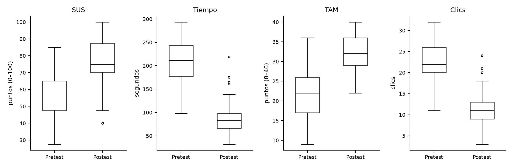
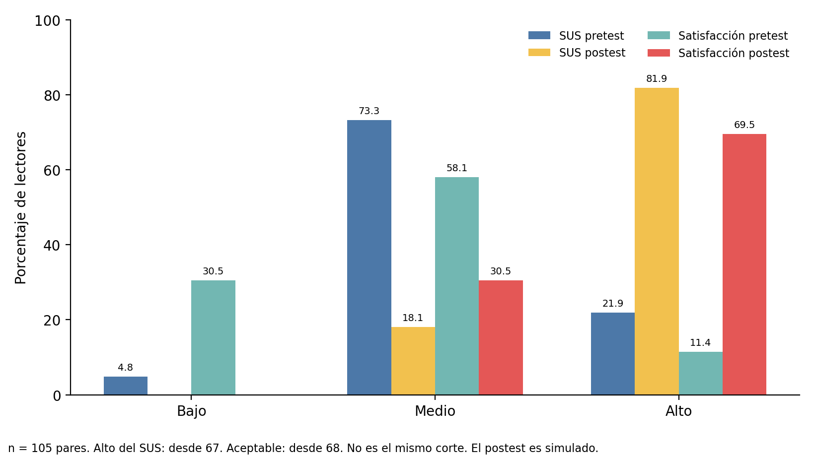

<!--
Tarea Académica 3 (Sesión 12). Cifras calculadas con `analisis/capitulo4.py` desde los cuadernos Excel.
Salida de respaldo (Anexo 10): `analisis/salidas/capitulo4.txt` y `analisis/salidas/figura-4-1.png`.
Si cambian los datos de los cuadernos, se vuelve a correr el script y se actualizan las cifras.
-->

# CAPÍTULO IV

## RESULTADOS

> **Nota.** No todas las cifras salen de los Excel 9, 10 y 11. El Excel 9 es la base consolidada (v1.0-simulada). El Excel 10 trae los descriptivos de los totales. El Excel 11 trae las hipótesis, la normalidad y la prueba elegida. Los factores del SUS y las dimensiones de la satisfacción se recalcularon desde los ítems del Excel 3 (pretest) y del Excel 7, hoja `6b_Base_Completa` (postest). El contraste, el intervalo y el tamaño del efecto no están en ningún Excel: los calculó `analisis/capitulo4.py`, porque la sesión 12 no tiene cuaderno. No son una medición de campo. El SUS del postest es simulado. La docente del curso autorizó el uso de esta base.

El capítulo presenta, primero, los resultados descriptivos organizados según los objetivos (4.1) y, después, los resultados inferenciales organizados según las hipótesis (4.2).

**Cómo se organiza este capítulo.** El apartado 4.1 sigue los objetivos. 4.1.1 caracteriza a los 108 lectores. 4.1.2 y 4.1.3 describen el pretest y el postest de los mismos 105. 4.1.4 ordena la usabilidad (objetivo específico 1), el tiempo y los clics (objetivo específico 2) y la satisfacción (objetivo específico 3). El apartado 4.2 plantea la hipótesis de cada objetivo, verifica los supuestos, ejecuta la prueba ya elegida y cierra con la hipótesis general. La sección «Cómo leer el conjunto de resultados» deja, para cada hipótesis, H₀, H₁, α, la prueba, el estadístico, el valor *p*, el intervalo de 95 % y la decisión. La población accesible fue de 150 lectores y la muestra de 108. De ellos, 105 completaron el pretest (O₁) y el postest (O₂); tres participantes (GU-TDH-015, GU-TDH-033 y GU-TDH-053) se retiraron durante la intervención por inasistencia fuera de la ventana y no tienen postest. La caracterización se informa sobre los 108 participantes y el análisis pretest–postest sobre los 105 pares completos. En todos los indicadores, la diferencia se calcula como postest menos pretest.

## 4.1 Resultados descriptivos

### 4.1.1 Caracterización de la muestra

Fuente. Excel 10, hoja `3_Caracterizacion`, sobre los 108 registros de la hoja `1_Base_v1`. Edad, zona, red y lecturas por semana están también en el Excel 9, hoja `5_Consolidada`, copiados del Excel 3.

En la Tabla 4.1 se observa que la muestra estuvo conformada mayoritariamente por lectores de zona urbana (67.6 %) y de 18 a 44 años (98.1 %), con una edad media de 30.01 años (*DE* = 5.61; rango de 20 a 50). Durante la aplicación, la mayoría se conectó por 4G (47.2 %) o por Wi-Fi (43.5 %). Los participantes leían el portal, en promedio, 8.80 veces por semana (*DE* = 3.69), en cumplimiento del criterio de inclusión de más de dos lecturas semanales.

**Tabla 4.1**
*Características de los lectores participantes (n = 108)*

| Característica | Categoría | *f* | % |
|---|---|---:|---:|
| Zona de residencia | Urbana | 73 | 67.6 |
| | Periurbana | 35 | 32.4 |
| Edad (años) | 18–29 | 58 | 53.7 |
| | 30–44 | 48 | 44.4 |
| | 45–59 | 2 | 1.9 |
| | 60 o más | 0 | 0.0 |
| Lecturas por semana | 3–6 | 35 | 32.4 |
| | 7–11 | 50 | 46.3 |
| | 12 o más | 23 | 21.3 |
| Red durante la aplicación | 3G | 8 | 7.4 |
| | 4G | 51 | 47.2 |
| | 5G | 2 | 1.9 |
| | Wi-Fi | 47 | 43.5 |

*Nota.* Porcentajes sobre 108. Edad: *M* = 30.01, *DE* = 5.61. Lecturas por semana: *M* = 8.80, *DE* = 3.69. Las categorías de edad y de frecuencia se fijaron antes de leer los datos.

**Pérdidas y comparabilidad.** De los 108 lectores del pretest, tres no tienen postest y no entran al contraste: GU-TDH-015, GU-TDH-033 y GU-TDH-053. En el Excel 9, hoja `3_Mortalidad`, el motivo es que no completaron las sesiones mínimas. La hoja `4_Conciliacion` los marca como retiro sin postest. No hubo reemplazo ni imputación. Los otros 105 son las mismas personas en el pretest y en el postest.

### 4.1.2 Resultados del pretest

Fuente. Los totales del SUS, el tiempo, los clics y la satisfacción salen del Excel 10, hojas `4_Descriptivos` y `7_Tablas_APA`. Los factores 1.1 y 1.2 del SUS y las dimensiones 3.1 y 3.2 se recalcularon desde los ítems del Excel 3, hoja `1. Base del pretest`. El Excel 9 y el Excel 10 no traen esos factores ya calculados.

En la Tabla 4.2 se observa que, con el portal actual, la usabilidad percibida media fue de 56.33 puntos (*DE* = 12.89), por debajo del umbral de aceptabilidad de 68 puntos del SUS. La facilidad de aprendizaje (*M* = 55.60) y la usabilidad general (*M* = 56.52) se ubicaron en el mismo rango. Los lectores tardaron en promedio 209.94 segundos (*DE* = 40.36) en localizar una noticia y realizaron 22.30 clics en las dos tareas. La satisfacción con la búsqueda alcanzó 22.00 puntos de 40 (*DE* = 6.01).

**Tabla 4.2**
*Estadísticos descriptivos de la experiencia de lectores en el pretest (n = 105)*

| Dimensión | Indicador | *M* | *DE* | *Me* | *Q*₁ | *Q*₃ | Mín. | Máx. |
|---|---|---:|---:|---:|---:|---:|---:|---:|
| Usabilidad percibida | SUS total (0–100) | 56.33 | 12.89 | 55.00 | 47.50 | 65.00 | 27.50 | 85.00 |
| | 1.1 Usabilidad general (0–100) | 56.52 | 13.55 | 56.25 | 46.88 | 65.62 | 28.12 | 87.50 |
| | 1.2 Facilidad de aprendizaje (0–100) | 55.60 | 16.53 | 50.00 | 50.00 | 62.50 | 12.50 | 100.00 |
| Tiempo de búsqueda | 2.1 Tiempo promedio (s) | 209.94 | 40.36 | 211.50 | 177.00 | 243.50 | 98.00 | 293.50 |
| | 2.2 Clics (dos tareas) | 22.30 | 5.21 | 22.00 | 20.00 | 26.00 | 11.00 | 32.00 |
| Satisfacción | Total (8–40) | 22.00 | 6.01 | 22.00 | 17.00 | 26.00 | 9.00 | 36.00 |
| | 3.1 Satisfacción general (6–30) | 16.60 | 4.65 | 16.00 | 13.00 | 20.00 | 7.00 | 27.00 |
| | 3.2 Intención de reutilización (2–10) | 5.40 | 1.66 | 5.00 | 4.00 | 7.00 | 2.00 | 10.00 |

*Nota.* *M* = media; *DE* = desviación estándar; *Me* = mediana; *Q*₁ y *Q*₃ = primer y tercer cuartil. Factores del SUS según Lewis y Sauro (2009): usabilidad general con ocho ítems y facilidad de aprendizaje con los ítems 4 y 10, ambos reescalados de 0 a 100. Tiempo: promedio de las tareas 1 y 2, con tope de 300 s.

### 4.1.3 Resultados del postest

Fuente. Los totales del postest salen del Excel 10, hojas `4_Descriptivos` y `7_Tablas_APA`, con los valores del Excel 7, hoja `6b_Base_Completa`. El Excel 9, hoja `5_Consolidada`, solo guarda el SUS del postest, no el tiempo, los clics ni los ítems. Los factores y las dimensiones del postest se recalcularon desde los ítems de la hoja `6b`.

En la Tabla 4.3 se observa que, tras siete días de uso de la aplicación, la usabilidad percibida media subió a 76.52 puntos (*DE* = 12.91), por encima del umbral de 68. El tiempo promedio de búsqueda bajó a 83.87 segundos (*DE* = 28.70) y los clics a 11.32. La satisfacción llegó a 32.28 puntos (*DE* = 4.49). El tiempo del postest mostró asimetría positiva (1.54) por cuatro valores atípicos altos (de 161.10 a 218.90 s), que se conservaron por tratarse de mediciones válidas.

**Tabla 4.3**
*Estadísticos descriptivos de la experiencia de lectores en el postest (n = 105)*

| Dimensión | Indicador | *M* | *DE* | *Me* | *Q*₁ | *Q*₃ | Mín. | Máx. |
|---|---|---:|---:|---:|---:|---:|---:|---:|
| Usabilidad percibida | SUS total (0–100) | 76.52 | 12.91 | 75.00 | 70.00 | 87.50 | 40.00 | 100.00 |
| | 1.1 Usabilidad general (0–100) | 75.92 | 13.16 | 75.00 | 68.75 | 87.50 | 43.75 | 100.00 |
| | 1.2 Facilidad de aprendizaje (0–100) | 78.93 | 16.29 | 75.00 | 75.00 | 87.50 | 25.00 | 100.00 |
| Tiempo de búsqueda | 2.1 Tiempo promedio (s) | 83.87 | 28.70 | 82.50 | 66.00 | 98.00 | 32.00 | 218.90 |
| | 2.2 Clics (dos tareas) | 11.32 | 3.76 | 11.00 | 9.00 | 13.00 | 3.00 | 24.00 |
| Satisfacción | Total (8–40) | 32.28 | 4.49 | 32.00 | 29.00 | 36.00 | 22.00 | 40.00 |
| | 3.1 Satisfacción general (6–30) | 24.30 | 3.33 | 24.00 | 22.00 | 27.00 | 17.00 | 30.00 |
| | 3.2 Intención de reutilización (2–10) | 7.98 | 1.43 | 8.00 | 7.00 | 9.00 | 5.00 | 10.00 |

*Nota.* Tiempo: promedio de las tareas 3 y 4, equivalentes a las del pretest. Abreviaturas como en la Tabla 4.2.

### 4.1.4 Resultados por objetivos, variable y dimensiones

Fuente. Niveles y diferencias de los totales: Excel 10, hojas `5_Niveles` y `6_Comparacion`. Las subdimensiones se recalcularon desde los ítems del Excel 3 y del Excel 7, hoja `6b_Base_Completa`. La interpretación descriptiva resume esas hojas y no usa el Excel 11.

**Objetivo específico 1: usabilidad percibida.** La Tabla 4.4 muestra que el porcentaje de lectores con usabilidad alta pasó de 21.9 % a 81.9 %, y que ninguno quedó en el nivel bajo en el postest. La proporción que alcanzó el umbral de aceptabilidad de 68 puntos subió de 16.2 % a 77.1 %. Según la Tabla 4.5, la media del SUS aumentó 20.19 puntos (35.8 %) y 101 de 105 lectores (96.2 %) mejoraron su puntaje. El aumento fue algo mayor en la facilidad de aprendizaje (+23.33) que en la usabilidad general (+19.40).

**Objetivo específico 2: tiempo de búsqueda.** El tiempo medio se redujo en 126.08 segundos (−60.1 %) y bajó en los 105 lectores. Los clics disminuyeron en 10.97 (−49.2 %), y 102 lectores (97.1 %) usaron menos clics.

**Objetivo específico 3: satisfacción.** El nivel alto pasó de 11.4 % a 69.5 % y el nivel bajo desapareció en el postest. La media total aumentó 10.28 puntos (46.7 %): 7.70 en satisfacción general y 2.58 en intención de reutilización.

**Objetivo general: experiencia de lectores.** Las tres dimensiones cambiaron en la dirección esperada en el nivel descriptivo. Estas diferencias se someten a contraste en el apartado 4.2.

**Tabla 4.4**
*Niveles de usabilidad percibida y de satisfacción en el pretest y el postest (n = 105)*

| Indicador | Nivel | Pretest *f* | Pretest % | Postest *f* | Postest % |
|---|---|---:|---:|---:|---:|
| SUS | Bajo (0–33) | 5 | 4.8 | 0 | 0.0 |
| | Medio (34–66) | 77 | 73.3 | 19 | 18.1 |
| | Alto (67–100) | 23 | 21.9 | 86 | 81.9 |
| | ≥ 68 (aceptable) | 17 | 16.2 | 81 | 77.1 |
| Satisfacción | Bajo (8–18) | 32 | 30.5 | 0 | 0.0 |
| | Medio (19–29) | 61 | 58.1 | 32 | 30.5 |
| | Alto (30–40) | 12 | 11.4 | 73 | 69.5 |

*Nota.* Cortes de nivel fijados antes de ver los datos (cuaderno de la sesión 10). El nivel alto empieza en 67. El umbral de aceptabilidad es 68 y se informa aparte; no reemplaza el corte.

**Tabla 4.5**
*Diferencias descriptivas entre el postest y el pretest (n = 105)*

| Indicador | *M* pretest | *M* postest | Diferencia | Cambio % | *Me* de la diferencia | Mín. | Máx. | Mejoraron *f* (%) |
|---|---:|---:|---:|---:|---:|---:|---:|---:|
| SUS total | 56.33 | 76.52 | 20.19 | 35.8 | 20.00 | −15.00 | 62.50 | 101 (96.2) |
| 1.1 Usabilidad general | 56.52 | 75.92 | 19.40 | 34.3 | 18.75 | −6.25 | 62.50 | 99 (94.3) |
| 1.2 Facilidad de aprendizaje | 55.60 | 78.93 | 23.33 | 42.0 | 25.00 | −50.00 | 62.50 | 90 (85.7) |
| 2.1 Tiempo (s) | 209.94 | 83.87 | −126.08 | −60.1 | −129.00 | −206.50 | −15.50 | 105 (100.0) |
| 2.2 Clics | 22.30 | 11.32 | −10.97 | −49.2 | −11.00 | −28.00 | 5.00 | 102 (97.1) |
| Satisfacción total | 22.00 | 32.28 | 10.28 | 46.7 | 11.00 | −4.00 | 22.00 | 102 (97.1) |
| 3.1 Satisfacción general | 16.60 | 24.30 | 7.70 | 46.4 | 8.00 | −3.00 | 17.00 | 100 (95.2) |
| 3.2 Intención de reutilización | 5.40 | 7.98 | 2.58 | 47.8 | 2.00 | −1.00 | 7.00 | 95 (90.5) |

*Nota.* Diferencia = postest − pretest. En tiempo y clics, una diferencia negativa indica mejora. Esta tabla describe magnitud y dirección; no decide hipótesis.

**Figura 4.1**
*Distribución de los indicadores en el pretest y el postest (n = 105)*

*Nota.* Caja: *Q*₁ a *Q*₃; línea: mediana; bigotes: 1.5 veces el rango intercuartílico; círculos: valores atípicos, conservados en el análisis. La Figura 4.1 se armó con los 105 pares del Excel 10, hoja `1_Base_v1`. La hoja `Figuras` de ese libro solo tiene medias y medianas, no los diagramas de caja. Las Tablas 4.1 a 4.5 corresponden a las hojas `3_Caracterizacion`, `4_Descriptivos`, `7_Tablas_APA`, `5_Niveles` y `6_Comparacion` del Excel 10.

**Figura 4.2**
*Porcentaje de lectores por nivel de SUS y de satisfacción (n = 105)*

*Nota.* Cada barra es la frecuencia del nivel dividida entre 105. Los cortes son los de la Tabla 4.4.

**Sustentación de la Figura 4.1.** Cada caja usa los 105 pares con INCLUIR = 1 de la hoja `1_Base_v1` del Excel 10. La caja va del primer al tercer cuartil, la línea es la mediana y el bigote llega al valor observado más extremo que todavía cae dentro de una vez y media el rango intercuartílico. El círculo es un valor fuera de ese límite: se dibuja y se conserva. Estas figuras describen la distribución; no contrastan hipótesis.

**SUS.** En el pretest la caja va de 47.50 a 65.00 y la mediana es 55.00, por debajo del umbral de 68. Los bigotes llegan a 27.50 y a 85.00, que son el mínimo y el máximo, porque ningún valor queda fuera de la cerca [21.25; 91.25]. En el postest la caja va de 70.00 a 87.50 y la mediana es 75.00. El bigote inferior se detiene en 47.50 y el superior en 100. Hay un solo círculo, en 40.00: es el mínimo de la tabla y queda bajo la cerca de 43.75. La caja del postest queda por encima de la mediana del pretest.

**Tiempo.** En el pretest la caja va de 177.00 a 243.50 segundos y la mediana es 211.50. Los bigotes son el mínimo y el máximo, 98.00 y 293.50, sin círculos. En el postest la caja va de 66.00 a 98.00 y la mediana es 82.50. El bigote inferior es 32.00 y el superior 138.60. Los cuatro círculos son 161.10, 164.80, 175.50 y 218.90, porque la cerca superior es 146.00 (98 + 1.5 × 32). El 218.90 es el máximo de la Tabla 4.3, no la punta del bigote.

**Satisfacción (TAM).** En el pretest la caja va de 17.00 a 26.00 y la mediana es 22.00. Los bigotes son 9.00 y 36.00, sin círculos. En el postest la caja va de 29.00 a 36.00 y la mediana es 32.00. Los bigotes son 22.00 y 40.00, sin círculos. Las dos cajas no se solapan: la del postest empieza en 29 y la del pretest termina en 26.

**Clics.** En el pretest la caja va de 20.00 a 26.00 y la mediana es 22.00. Los bigotes son 11.00 y 32.00, sin círculos. En el postest la caja va de 9.00 a 13.00 y la mediana es 11.00. El bigote inferior es 3.00 y el superior 18.00. Los cuatro círculos son 20, 21, 24 y 24: la cerca superior es 19.00 (13 + 1.5 × 4), así que 20 ya queda fuera. El máximo de la tabla, 24, no es la punta del bigote.

**Sustentación de la Figura 4.2.** Cada barra es el número de lectores del nivel dividido entre 105 y multiplicado por 100, con un decimal. Los cortes están en la hoja `2_Derivadas` del Excel 10 y los conteos en la hoja `5_Niveles`. Si una barra no aparece, el conteo es 0.

**SUS, niveles.** Bajo es 0 a 33, medio 34 a 66 y alto 67 a 100. En el pretest hay 5, 77 y 23 lectores, es decir 4.8 %, 73.3 % y 21.9 %. En el postest hay 0, 19 y 86, es decir 0 %, 18.1 % y 81.9 %. Cada trío suma 105. El nivel alto empieza en 67 y no es el umbral de aceptabilidad de 68: ese umbral lo alcanzan 17 lectores en el pretest (16.2 %) y 81 en el postest (77.1 %), y no está dibujado en esta figura.

**Satisfacción, niveles.** Bajo es 8 a 18, medio 19 a 29 y alto 30 a 40. En el pretest hay 32, 61 y 12 lectores: 30.5 %, 58.1 % y 11.4 %. En el postest hay 0, 32 y 73: 0 %, 30.5 % y 69.5 %. Cada trío suma 105. En el postest no se dibuja la barra de nivel bajo.

## 4.2 Resultados inferenciales

### 4.2.1 Hipótesis estadísticas

Fuente. Excel 11, hoja `2_Hipotesis`: H₀, H₁, contraste bilateral y α = .05, declarados antes de ver el valor *p*. La regla de la hipótesis general está en el proyecto, sección 3.6.4.

Las hipótesis del proyecto (sección 2.4) no indican dirección. Por eso, para cada dimensión se plantea un contraste bilateral sobre la diferencia *D* = postest − pretest, con α = .05, fijado antes del análisis:

| Hipótesis | Variable | H₀ | H₁ |
|---|---|---|---|
| HE1 | Usabilidad percibida (SUS) | *Me*_D = 0 | *Me*_D ≠ 0 |
| HE2 | Tiempo de búsqueda (s) | μ_D = 0 | μ_D ≠ 0 |
| HE3 | Satisfacción (8–40) | μ_D = 0 | μ_D ≠ 0 |
| HG | Experiencia de lectores | No se rechaza ninguna H₀ específica | Se rechazan las tres H₀ específicas |

Según la regla de la sección 3.6.4 del proyecto, la hipótesis general se rechaza solo si se rechazan las tres hipótesis nulas específicas. Los clics se analizan como indicador complementario del tiempo y no deciden la HE2.

### 4.2.2 Verificación de supuestos

Fuente. Excel 11, hoja `3_Normalidad` (*D* y *p* de Lilliefors), hoja `4_QQ` y hoja `5_Levene` (no se calcula). El *D* del capítulo es el de esa ficha. El *p* del texto usa la aproximación de Lilliefors; el Excel 11 guarda la simulación (.027, .841, .230 y .221). La decisión de normalidad es la misma.

**Normalidad.** Como n = 105 es mayor que 50, la normalidad de cada diferencia se evaluó con la prueba de Kolmogorov-Smirnov con corrección de Lilliefors (Tabla 4.6). La diferencia del SUS no siguió una distribución normal (*D* = .092, *p* = .028). Las diferencias de tiempo, satisfacción y clics sí la siguieron (*p* > .05). La ficha de verificación se cerró en la sesión 11, antes de contrastar.

**Homogeneidad de varianzas.** No se aplica: hay un solo grupo y las mediciones están relacionadas, así que la prueba de Levene no corresponde.

**Independencia y nivel de medición.** Cada fila corresponde a un participante distinto, y el pretest y el postest del mismo lector forman un par. El SUS y la satisfacción son puntajes sumados de diez y ocho ítems, que se tratan como de intervalo. El tiempo y los clics están en escala de razón. Los valores atípicos del tiempo del postest se conservaron.

**Tabla 4.6**
*Prueba de normalidad de las diferencias postest − pretest (n = 105)*

| Diferencia | *M* | *DE* | Asimetría | Curtosis | *D* (Lilliefors) | *p* | Decisión |
|---|---:|---:|---:|---:|---:|---:|---|
| SUS | 20.19 | 12.28 | 0.55 | 1.28 | .092 | .028 | No normal |
| Tiempo (s) | −126.08 | 43.13 | 0.41 | −0.19 | .047 | .843 | Normal |
| Satisfacción | 10.28 | 5.39 | −0.19 | −0.30 | .070 | .245 | Normal |
| Clics | −10.97 | 5.72 | 0.08 | 0.01 | .071 | .237 | Normal |

*Nota.* Criterio: *p* ≥ .05 indica que se asume normalidad. Los valores *D* coinciden con la ficha de la sesión 11; los *p* difieren en milésimas según el método de aproximación (sesión 11: .027, .841, .230 y .221), sin cambiar ninguna decisión.

### 4.2.3 Prueba estadística seleccionada

Fuente. Excel 11, hoja `6_Matriz_Seleccion`. La prueba sale de la decisión de la hoja `3_Normalidad`.

**Tabla 4.7**
*Prueba seleccionada por hipótesis*

| Hipótesis | Diferencia | Normalidad | Prueba | Tamaño del efecto |
|---|---|---|---|---|
| HE1 | SUS | No | Rangos con signo de Wilcoxon | *r* = *Z* / √*n* |
| HE2 | Tiempo | Sí | *t* de Student para muestras relacionadas | *d*_z y *g* de Hedges |
| HE3 | Satisfacción | Sí | *t* de Student para muestras relacionadas | *d*_z y *g* de Hedges |
| Complementaria | Clics | Sí | *t* de Student para muestras relacionadas | *d*_z y *g* de Hedges |

*Nota.* La prueba se eligió por el resultado de la normalidad, no por el resultado esperado. Criterios para interpretar el tamaño del efecto (Cohen, 1988): *d* pequeño 0.20, mediano 0.50, grande ≥ 0.80; *r* pequeño .10, mediano .30, grande ≥ .50.

### 4.2.4 Contrastación de las hipótesis específicas

Fuente. La prueba es la del Excel 11. El estadístico, el valor *p*, el intervalo de confianza y el tamaño del efecto no están en ese libro: los calculó `analisis/capitulo4.py` sobre las diferencias de la hoja `1_Base_v1` del Excel 11, que son las mismas del Excel 10, hoja `2_Derivadas`. No hay Excel de la sesión 12.

#### Hipótesis específica 1: usabilidad percibida

**Planteamiento.** H₀: la mediana de la diferencia del SUS es igual a 0. H₁: es distinta de 0. α = .05, bilateral. Como la diferencia no es normal, se aplica la prueba de Wilcoxon.

**Estadístico y valor *p*.** De los 105 pares, 2 no cambiaron y no entran en el cálculo (*n* efectivo = 103). La suma de rangos positivos fue 5316 y la de negativos 40, con *Z* = 8.69 y *p* < .001.

**Intervalo de confianza.** La mediana de la diferencia fue de 20.00 puntos. El estimador de Hodges-Lehmann fue de 20.00 puntos, con un IC 95 % de [17.50; 22.50]. El intervalo no incluye el 0.

**Tamaño del efecto.** *r* = .85, grande. Como análisis de sensibilidad, la *t* relacionada sobre la misma diferencia da el mismo resultado (*t*(104) = 16.85, *p* < .001, *d*_z = 1.64).

**Decisión e interpretación.** Se rechaza H₀. La usabilidad percibida de los lectores fue mayor con la aplicación que con el portal actual, con una diferencia mediana de 20 puntos. En el plano práctico, el puntaje típico cruzó el umbral de aceptabilidad de 68 (de 55.00 a 75.00 de mediana), y la proporción de lectores que lo alcanzó pasó de 16.2 % a 77.1 %. Este resultado responde al objetivo específico 1.

**Tabla 4.8**
*Prueba de Wilcoxon para la usabilidad percibida (n = 105)*

| Indicador | *Me* pretest | *Me* postest | *Me* de la diferencia | Rangos + / − | *Z* | *p* | HL [IC 95 %] | *r* |
|---|---:|---:|---:|---:|---:|---:|---:|---:|
| SUS | 55.00 | 75.00 | 20.00 | 5316 / 40 | 8.69 | < .001 | 20.00 [17.50; 22.50] | .85 |

*Nota.* HL = estimador de Hodges-Lehmann de la diferencia. *Z* con corrección por empates. Dos pares sin cambio excluidos del cálculo de rangos.

#### Hipótesis específica 2: tiempo de búsqueda

**Planteamiento.** H₀: μ_D = 0. H₁: μ_D ≠ 0. α = .05, bilateral. La diferencia es normal, así que se aplica la *t* de Student para muestras relacionadas.

**Estadístico y valor *p*.** *t*(104) = −29.96, *p* < .001.

**Intervalo de confianza.** La diferencia media fue de −126.08 segundos (*DE* = 43.13), con un IC 95 % de [−134.42; −117.73]. El intervalo es negativo y no incluye el 0.

**Tamaño del efecto.** *d*_z = −2.92 y *g* = −2.90, grande.

**Decisión e interpretación.** Se rechaza H₀. El tiempo para localizar una noticia fue menor con la aplicación: unos dos minutos menos por tarea (−60.1 %), y la reducción se observó en los 105 lectores. El indicador complementario va en la misma dirección: los clics bajaron en 10.97 (*t*(104) = −19.66, *p* < .001, IC 95 % [−12.08; −9.86], *d*_z = −1.92). Este resultado responde al objetivo específico 2.

**Tabla 4.9**
*Prueba t para muestras relacionadas del tiempo de búsqueda y los clics (n = 105)*

| Indicador | *M* pretest | *M* postest | *M*_D | *DE*_D | IC 95 % | *t*(104) | *p* | *d*_z | *g* |
|---|---:|---:|---:|---:|---:|---:|---:|---:|---:|
| Tiempo (s) | 209.94 | 83.87 | −126.08 | 43.13 | [−134.42; −117.73] | −29.96 | < .001 | −2.92 | −2.90 |
| Clics (complementario) | 22.30 | 11.32 | −10.97 | 5.72 | [−12.08; −9.86] | −19.66 | < .001 | −1.92 | −1.90 |

*Nota.* *M*_D = media de la diferencia postest − pretest. Un valor negativo indica reducción.

#### Hipótesis específica 3: satisfacción

**Planteamiento.** H₀: μ_D = 0. H₁: μ_D ≠ 0. α = .05, bilateral. La diferencia es normal, así que se aplica la *t* de Student para muestras relacionadas.

**Estadístico y valor *p*.** *t*(104) = 19.54, *p* < .001.

**Intervalo de confianza.** La diferencia media fue de 10.28 puntos (*DE* = 5.39), con un IC 95 % de [9.23; 11.32]. El intervalo no incluye el 0.

**Tamaño del efecto.** *d*_z = 1.91 y *g* = 1.89, grande.

**Decisión e interpretación.** Se rechaza H₀. La satisfacción fue mayor con la aplicación, con un aumento medio de 10.28 puntos en una escala de 8 a 40. El cambio alcanzó tanto a la satisfacción general (+7.70) como a la intención de reutilización (+2.58). Este resultado responde al objetivo específico 3.

**Tabla 4.10**
*Prueba t para muestras relacionadas de la satisfacción (n = 105)*

| Indicador | *M* pretest | *M* postest | *M*_D | *DE*_D | IC 95 % | *t*(104) | *p* | *d*_z | *g* |
|---|---:|---:|---:|---:|---:|---:|---:|---:|---:|
| Satisfacción (8–40) | 22.00 | 32.28 | 10.28 | 5.39 | [9.23; 11.32] | 19.54 | < .001 | 1.91 | 1.89 |

### 4.2.5 Contrastación de la hipótesis general

Fuente. Decisión por la regla del proyecto, sección 3.6.4, aplicada a los tres contrastes anteriores. El Excel 11 no contrasta la hipótesis general. El criterio de Bonferroni (α/3 = .017) es un control del capítulo, no una celda del Excel.

Se rechazaron las tres hipótesis nulas específicas (Tabla 4.11). Según la regla declarada en el proyecto, **se rechaza la H₀ general**: la experiencia de lectores difirió entre el portal actual y la aplicación multiplataforma de búsqueda semántica conversacional, en las tres dimensiones y en la dirección favorable. La conclusión se mantiene con un criterio más estricto: con la corrección de Bonferroni (α/3 = .017), las tres pruebas siguen por debajo del umbral.

**Tabla 4.11**
*Resumen de la contrastación de hipótesis (α = .05, bilateral; n = 105)*

| Hipótesis | Prueba | Estadístico | *p* | Tamaño del efecto | Decisión |
|---|---|---|---:|---|---|
| HE1 Usabilidad percibida | Wilcoxon | *Z* = 8.69 | < .001 | *r* = .85 (grande) | Se rechaza H₀ |
| HE2 Tiempo de búsqueda | *t* relacionada | *t*(104) = −29.96 | < .001 | *d*_z = −2.92 (grande) | Se rechaza H₀ |
| HE3 Satisfacción | *t* relacionada | *t*(104) = 19.54 | < .001 | *d*_z = 1.91 (grande) | Se rechaza H₀ |
| HG Experiencia de lectores | Regla de las tres HE | — | — | — | Se rechaza H₀ |

### Cómo leer el conjunto de resultados

Para cada hipótesis se lee la fila completa: planteamiento, ejecución, intervalo, tamaño del efecto y decisión. La ejecución sale de las 105 diferencias de la hoja `1_Base_v1` del Excel 11, con la prueba de la hoja `6_Matriz_Seleccion`. Wilcoxon usa la aproximación normal con corrección por empates. La *t* relacionada usa la media de la diferencia y 104 grados de libertad. El registro del cálculo está en `analisis/salidas/capitulo4.txt`.

| Hipótesis | H₀, H₁, α y prueba | Estadístico y *p* | IC 95 % y efecto | Decisión |
|---|---|---|---|---|
| HE1 Usabilidad | H₀: *Me*_D = 0. H₁: *Me*_D ≠ 0. α = .05. Wilcoxon. | *Z* = 8.69. *p* < .001. | [17.50; 22.50]. *r* = .85. | Se rechaza H₀. |
| HE2 Tiempo | H₀: μ_D = 0. H₁: μ_D ≠ 0. α = .05. *t* relacionada. | *t*(104) = −29.96. *p* < .001. | [−134.42; −117.73]. *d*_z = −2.92. | Se rechaza H₀. |
| Clics | Complemento. No decide la HE2. | *t*(104) = −19.66. *p* < .001. | [−12.08; −9.86]. *d*_z = −1.92. | No decide la HE2. |
| HE3 Satisfacción | H₀: μ_D = 0. H₁: μ_D ≠ 0. α = .05. *t* relacionada. | *t*(104) = 19.54. *p* < .001. | [9.23; 11.32]. *d*_z = 1.91. | Se rechaza H₀. |
| HG Experiencia | H₀: no se rechaza alguna específica. H₁: se rechazan las tres. Regla §3.6.4. | Tres de tres con *p* < .001. Bonferroni α/3 = .017. | Ningún intervalo incluye el 0. | Se rechaza H₀. |

*Nota.* La decisión usa solo «se rechaza H₀» o «no se rechaza H₀». No se dice que se acepta H₀.

### 4.2.6 Interpretación estadística y práctica

Fuente. Lectura de las tablas de contraste de este capítulo. No añade cifras de otro Excel. El umbral de 68 puntos del SUS está declarado en el proyecto; el Excel 10 solo lo usa como referencia descriptiva.

**Estadística.** En las tres dimensiones, el valor *p* fue menor que .001, el intervalo de confianza de la diferencia no incluyó el 0 y el tamaño del efecto fue grande. Las diferencias son estadísticamente significativas y en la dirección esperada.

**Práctica.** La significancia por sí sola no basta, porque con 105 pares incluso un efecto pequeño puede dar *p* < .05. La relevancia se juzga con la magnitud del cambio:

- Usabilidad: la mediana pasó de un valor por debajo del umbral de aceptabilidad de 68 a uno por encima, en una escala cuyo criterio es conocido.
- Tiempo: la reducción típica fue de unos dos minutos por noticia, sobre una línea base de tres minutos y medio.
- Satisfacción: el lector típico pasó del nivel medio al alto.

**Alcances.**
1. **Sin causalidad estricta.** El diseño es preexperimental, de un solo grupo y sin grupo de comparación. El cambio se interpreta como asociado al uso de la aplicación durante siete días, no como efecto causal: no se descarta la influencia de la novedad, de la repetición de la medición ni de eventos externos (sección 1.5).
2. **Tamaños del efecto atípicos.** Valores como *d*_z = 2.92 son inusuales en estudios de usabilidad. Aquí reflejan la base simulada del seminario y no deben extrapolarse a otras poblaciones.
3. **Cambio mínimo relevante.** El proyecto solo declara el umbral de 68 para el SUS. Para el tiempo y la satisfacción no definió antes del análisis un cambio mínimo relevante, así que la relevancia práctica de esas dimensiones se argumenta con la magnitud del efecto y la escala del instrumento.
